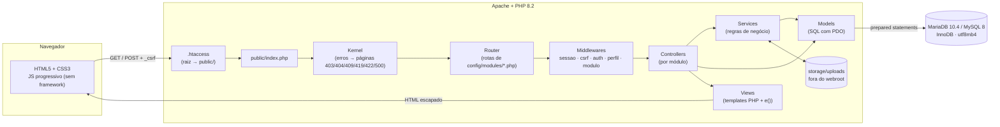
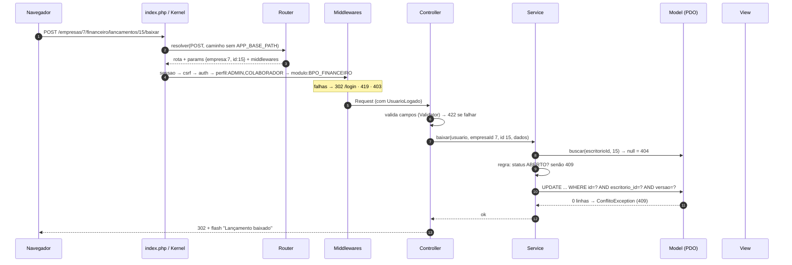

# Arquitetura do Tributo

> **Fonte de verdade técnica.** Toda implementação (humana ou por IA) segue este documento.
> Mudanças aqui exigem aprovação e registro em [DECISIONS.md](DECISIONS.md).
> Situação: **planejado, aguardando aprovação** (ver [ROADMAP.md](ROADMAP.md)).

## Sumário

1. [Premissas](#1-premissas)
2. [Visão geral](#2-visão-geral)
3. [Estrutura de pastas](#3-estrutura-de-pastas)
4. [Módulos e o contrato de extensão](#4-módulos-e-o-contrato-de-extensão)
5. [Componentes do núcleo (contratos)](#5-componentes-do-núcleo-contratos)
6. [Convenções de código](#6-convenções-de-código)
7. [Multi-tenant e autorização](#7-multi-tenant-e-autorização)
8. [Segurança](#8-segurança)
9. [Ambientes: local, testes e produção](#9-ambientes-local-testes-e-produção)
10. [Regras de negócio com fórmula definida](#10-regras-de-negócio-com-fórmula-definida)
11. [Fluxos principais](#11-fluxos-principais)
12. [Estratégia de testes](#12-estratégia-de-testes)

---

## 1. Premissas

| # | Premissa | Consequência |
|---|----------|--------------|
| P1 | Ambiente local: **XAMPP com PHP 8.2.12 e MariaDB 10.4.32** (verificado nesta máquina) | Todo SQL deve funcionar em **MariaDB 10.4** e também em **MySQL 8.0.16+** (hospedagem) |
| P2 | Hospedagem compartilhada com PHP 8.2+ e MySQL/MariaDB, provavelmente **sem SSH** | O deploy envia a pasta `vendor/` já gerada (`--no-dev`); o banco é importado via phpMyAdmin; o SQL **não** contém `CREATE DATABASE` |
| P3 | A versão local é a alternativa garantida para a apresentação | Seed completo e comando de reconstrução do banco com um passo |
| P4 | Prazo de cerca de 7 dias, com desenvolvimento assistido por várias IAs | Tarefas pequenas, com posse exclusiva de arquivos e contratos fixos (ver [AGENTS.md](../AGENTS.md)) |
| P5 | Quem desenvolve é estudante e precisa explicar o código | Sem framework; classes pequenas; nomes de domínio em português; comentários explicando o "porquê" |
| P6 | Escritórios são criados pelo seed (sem cadastro self-service) | Não existe super-administrador na R1 |
| P7 | Todos os dados de exemplo são fictícios | E-mails `@exemplo.test`, CNPJs gerados com dígito verificador válido sem correspondência real |

## 2. Visão geral

**Monólito modular em MVC**, renderizado no servidor, com um único ponto de entrada (`public/index.php`).



**Ciclo de uma requisição autenticada:**



## 3. Estrutura de pastas

```
tributo/
├── .htaccess                    # raiz → public/ (XAMPP em subpasta e hospedagem sem DocumentRoot)
├── AGENTS.md                    # regras para qualquer IA ou pessoa que implemente tarefas
├── CLAUDE.md                    # importa AGENTS.md (Claude Code)
├── .github/copilot-instructions.md  # resumo de AGENTS.md (GitHub Copilot)
├── composer.json / composer.lock
├── phpunit.xml / phpstan.neon
├── .env.example / .env.production.example
├── public/                      # ÚNICA pasta acessível pelo navegador
│   ├── index.php                # front controller
│   ├── .htaccess
│   └── assets/{css,js}/         # (F09)
├── app/
│   ├── Core/                    # infraestrutura: Router, Request, Response, Kernel, Container, View,
│   │                            #   Session, Csrf, Validator, Database, Config, Env, Model, Controller,
│   │                            #   Paginacao, Pagina, UsuarioLogado, Modulos, helpers.php
│   ├── Middleware/              # SessaoMiddleware, CsrfMiddleware, AuthMiddleware, GuestMiddleware,
│   │                            #   PerfilMiddleware, ModuloMiddleware
│   ├── Exceptions/              # NaoEncontradoException, AcessoNegadoException, ConflitoException,
│   │                            #   ModuloInativoException, CsrfException
│   ├── Support/                 # Relogio (+RelogioSistema, RelogioFixo), Cnpj, Dinheiro, Competencia
│   ├── Controllers/<Modulo>/    # Modulo ∈ Nucleo, Cadastro, Fiscal, Documentos, Portal,
│   ├── Models/<Modulo>/         #          Financeiro, Gestao, Consultivo
│   ├── Services/<Modulo>/
│   └── Views/
│       ├── layouts/             # app.php, portal.php, auth.php, impressao.php
│       ├── partials/            # flash, paginacao, campo-erro, semaforo, abas-empresa, aviso-gerencial
│       ├── erros/               # 403, 404, 405, 409, 419, 500, modulo-inativo
│       └── <modulo>/<recurso>/  # pastas em minúsculas: nucleo, cadastro, fiscal, documentos, portal,
│                                #   financeiro, gestao, consultivo → index.php, form.php, show.php ...
├── config/
│   ├── app.php                  # lê o .env e expõe a configuração tipada
│   ├── regras/                  # pesos e limites de índices e alertas: regularidade.php (GE01), radar.php (CO03)
│   └── modules/                 # um arquivo por módulo: rotas, menu, abas, cartões do painel
│       ├── nucleo.php  cadastro.php  fiscal.php  documentos.php
│       ├── financeiro.php  gestao.php  consultivo.php  portal.php
├── database/
│   ├── schema/                  # 01_nucleo.sql 02_fiscal.sql 03_documentos.sql 04_financeiro.sql 05_consultivo.sql
│   ├── seeds/                   # mesmos números, só com dados fictícios
│   └── tributo.sql              # GERADO por `php bin/db.php build` (importação via phpMyAdmin)
├── bin/
│   ├── lint.php                 # php -l em todo o projeto
│   └── db.php                   # rebuild | build | seed (F02)
├── storage/{logs,uploads,cache}/  # graváveis, fora do Git
├── tests/
│   ├── Unit/<Modulo>/  Integration/<Modulo>/  E2E/
│   ├── Support/                 # BancoDeTeste, Fabrica<Modulo>.php, ClienteHttp (E2E)
│   └── bootstrap.php
└── docs/                        # PRODUCT, ARCHITECTURE, DATABASE, API, ROADMAP, DECISIONS, TESTE-USUARIO
```

Mapeamento de namespaces (PSR-4): `App\` → `app/`, `Tests\` → `tests/`.
Exemplo: `App\Controllers\Fiscal\ObrigacaoController` → `app/Controllers/Fiscal/ObrigacaoController.php`.

## 4. Módulos e o contrato de extensão

Cada área do produto é um **módulo**. Um módulo é composto por:

- pastas próprias em `Controllers/`, `Models/`, `Services/`, `Views/` e `tests/`;
- um arquivo SQL próprio em `database/schema/` e outro em `database/seeds/`;
- **um arquivo de configuração `config/modules/<modulo>.php`**, que é o único ponto de integração com o restante do sistema.

Isso permite que tarefas de módulos diferentes rodem em paralelo **sem editar os mesmos arquivos**.

### 4.1 Formato de `config/modules/<modulo>.php`

```php
<?php
declare(strict_types=1);

use App\Controllers\Fiscal\ObrigacaoController;

return [
    // Código do módulo contratável. null = faz parte do Plano Base (sempre ativo).
    // Valores possíveis: null | 'BPO_FINANCEIRO' | 'CONSULTIVO'
    'contratavel' => null,

    // Itens do menu lateral. 'perfis' filtra quem vê o item.
    'menu' => [
        ['rotulo' => 'Obrigações', 'url' => '/obrigacoes', 'icone' => 'calendario',
         'perfis' => ['ADMIN', 'COLABORADOR'], 'ordem' => 30],
    ],

    // Abas exibidas na página da empresa (/empresas/{id}). {id} é substituído.
    'abas_empresa' => [
        ['rotulo' => 'Obrigações', 'url' => '/obrigacoes?empresa_id={id}', 'ordem' => 20],
    ],

    // Classes que implementam App\Core\CartaoPainel (exibidas em /painel).
    'cartoes_painel' => [],

    // [método, padrão, [Controller::class, 'acao'], [middlewares]]
    // 'sessao' e 'csrf' (em POST) são globais e não precisam ser listados.
    'rotas' => [
        ['GET',  '/obrigacoes',              [ObrigacaoController::class, 'index'],  ['auth', 'perfil:ADMIN,COLABORADOR']],
        ['POST', '/obrigacoes/{id}/status',  [ObrigacaoController::class, 'status'], ['auth', 'perfil:ADMIN,COLABORADOR']],
    ],
];
```

Regras:

- Quando `contratavel` não é `null`, o carregador **acrescenta `modulo:<CODIGO>` a todas as rotas** do arquivo e oculta o menu, as abas e os cartões para escritórios sem o módulo.
- `App\Core\Modulos` carrega todos os arquivos de `config/modules/` em ordem alfabética, valida o formato e registra as rotas. Uma rota duplicada (mesmo método + padrão) gera exceção na inicialização (o erro aparece em teste, não em produção).
- Rotas, menus e abas usam caminhos **sem** `APP_BASE_PATH`; o helper `url()` acrescenta o prefixo.

### 4.2 Interface `App\Core\CartaoPainel`

```php
interface CartaoPainel
{
    public function titulo(): string;
    /** Dados prontos para a view; deve respeitar escritório e perfil do usuário. */
    public function dados(UsuarioLogado $usuario): array;
    /** Template relativo a app/Views, ex.: 'financeiro/painel/_cartao'. */
    public function template(): string;
    public function ordem(): int;
}
```

## 5. Componentes do núcleo (contratos)

> Assinaturas **obrigatórias**. Tarefas de módulo usam estes contratos e não os alteram.
> Uma mudança de contrato do núcleo é uma tarefa própria, sequencial, aprovada antes.

| Classe | Responsabilidade | API pública |
|--------|------------------|-------------|
| `Core\Env` | Ler o `.env` (sem dependências externas) | `static carregar(string $arquivo): void` · `static obter(string $chave, ?string $padrao = null): ?string` |
| `Core\Config` | Configuração em notação de ponto | `static obter(string $chave, mixed $padrao = null): mixed` (ex.: `Config::obter('db.host')`) |
| `Core\Database` | Conexão PDO única por requisição | `static conexao(): PDO` · `static transacao(callable $fn): mixed` (commit/rollback automático) |
| `Support\Relogio` (interface) | Data e hora injetáveis (testes de vencimento e atraso) | `hoje(): DateTimeImmutable` · `agora(): DateTimeImmutable` — implementações `RelogioSistema`, `RelogioFixo` |
| `Core\Request` | Encapsular as superglobais | `metodo()`, `caminho()`, `query(string $k, mixed $padrao = null)`, `input(string $k, mixed $padrao = null)`, `todos(): array`, `arquivo(string $k): ?array`, `ip()`, `usuario(): UsuarioLogado` (lança exceção se ausente), `comUsuario(UsuarioLogado): self` |
| `Core\Response` | Construir respostas | `static html(string $corpo, int $status = 200)`, `static redirecionar(string $caminho)`, `static download(string $arquivo, string $nome, string $mime)`, `comHeader()`, `enviar(): void` |
| `Core\Router` | Associar método + caminho a um handler | `adicionar(string $metodo, string $padrao, array $handler, array $middlewares)`, `resolver(string $metodo, string $caminho): RotaResolvida` (404/405). Parâmetros `{nome}` aceitam apenas `[0-9]+` |
| `Core\Container` | Instanciar controllers e services com autowiring por reflexão | `get(string $classe): object` · `definir(string $classe, object\|callable $instancia)` |
| `Core\Kernel` | Orquestrar a requisição e mapear exceções para status | `tratar(Request): Response` |
| `Core\Controller` (base) | Atalhos para controllers | `view(string $tpl, array $dados = [], int $status = 200, string $layout = 'app'): Response` · `redirecionar(string $url, ?string $flashSucesso = null): Response` · `voltarComErros(string $tpl, array $erros, array $antigos, array $dados = []): Response` (422) |
| `Core\View` | Renderizar template dentro do layout | `render(string $tpl, array $dados, string $layout): string` |
| `app/Core/helpers.php` | Funções globais das views | `e(?string): string` · `url(string $caminho, array $query = []): string` · `csrf_campo(): string` · `antigo(string $campo, mixed $padrao = '')` · `erro_campo(array $erros, string $campo): string` · `dinheiro(int $centavos): string` · `data_br(?string): string` |
| `Core\Session` | Sessão segura e flash | `iniciar()`, `obter()`, `definir()`, `remover()`, `regenerar()`, `destruir()`, `flash(string $tipo, string $msg)`, `consumirFlash(): array` |
| `Core\Csrf` | Token por sessão | `token(): string`, `validar(?string $token): bool` (`hash_equals`) |
| `Core\Validator` | Validação com erros por campo | `Validator::validar(array $dados, array $regras): array` (vazio = válido). Regras em string: `obrigatorio\|max:150\|email\|cnpj\|data\|competencia\|inteiro\|decimal\|em:A,B\|min:1\|depois_ou_igual:campo` |
| `Core\Model` (base) | Acesso a dados | `protected PDO $db` · `buscarUm(string $sql, array $p): ?array` · `buscarTodos(string $sql, array $p): array` · `executar(string $sql, array $p): int` (linhas afetadas) · `inserir(string $sql, array $p): int` (id) · `paginar(string $sqlSelect, string $sqlCount, array $p, Paginacao $pg): Pagina` |
| `Core\Paginacao` / `Core\Pagina` | Paginação | `Paginacao::deRequest(Request, int $porPagina = 20)`; `Pagina { itens, total, pagina, porPagina, totalPaginas }` |
| `Core\UsuarioLogado` (readonly) | Contexto do usuário | `id`, `escritorioId`, `perfil`, `empresaId` (só CLIENTE), `nome`, `modulos` (array de códigos) · `ehAdmin()`, `ehCliente()`, `temModulo(string)` |
| `Services\Nucleo\AuditoriaService` | Trilha de auditoria | `registrar(UsuarioLogado $u, string $entidade, int $id, string $acao, array $detalhes = []): void` |

**Exceções e status HTTP** (o Kernel converte):

| Exceção | Status | Página |
|---------|--------|--------|
| `NaoEncontradoException` | 404 | `erros/404` (inclusive para recurso de **outro escritório**) |
| `AcessoNegadoException` | 403 | `erros/403` |
| `ModuloInativoException` | 403 | `erros/modulo-inativo` (texto comercial: "Módulo não contratado") |
| `ConflitoException` | 409 | Re-renderiza o formulário com a mensagem, ou volta com flash de erro |
| `CsrfException` | 419 | `erros/419` |
| Qualquer outra | 500 | `erros/500` (detalhes só com `APP_DEBUG=true`); grava log em `storage/logs` |

A validação **não** usa exceção: o controller chama `Validator::validar()` e, se houver erros, retorna `voltarComErros()` (422).

## 6. Convenções de código

1. `declare(strict_types=1);` em todo arquivo PHP. Tipagem de parâmetros e retornos em todo método.
2. **Domínio em português** (`Empresa`, `Obrigacao`, `listar`, `baixar`); **infraestrutura** com nomes técnicos consagrados (`Router`, `Request`, `Kernel`).
3. **Controllers magros:** leem a requisição, validam, chamam o service ou model e escolhem a view. Sem SQL.
4. **Services** contêm regras (transições de status, cálculos, transações). Sem HTML e sem `$_POST`.
5. **Models** contêm SQL. **Todo método público recebe `int $escritorioId` como primeiro parâmetro** e filtra por ele. Nomes padrão:
   - `listar(int $escritorioId, array $filtros, Paginacao $pg): Pagina`
   - `buscar(int $escritorioId, int $id): ?array`
   - `criar(int $escritorioId, array $dados): int`
   - `atualizar(int $escritorioId, int $id, array $dados, int $versao): void` (lança `ConflitoException` se 0 linhas)
   - `excluir(int $escritorioId, int $id): void`
6. Registros trafegam como **arrays associativos** com PHPDoc (`@return array<string, mixed>|null`).
7. **SQL:** somente prepared statements com parâmetros nomeados. `ORDER BY` só com uma *whitelist* (`QueryFiltros::ordenacao()`). Em `LIKE`, escapar `%`, `_` e `\`.
8. **Dinheiro:** no banco, `DECIMAL(15,2)`; em PHP, **inteiro em centavos** via `Support\Dinheiro` (`deDecimal('1234.50')`, `deEntradaBr('1.234,50')`, `paraDecimal()`, `formatar()`). Nunca usar `float`.
9. **Datas:** `DateTimeImmutable`; "hoje" sempre vem de `Relogio` (nunca `date()` direto em service).
10. **Views:** toda saída com `<?= e($valor) ?>`. Todo `<form method="post">` contém `<?= csrf_campo() ?>`. Sem JS inline (a CSP bloqueia). Os formulários funcionam sem JS.
11. **PRG:** toda mutação bem-sucedida termina em redirecionamento.
12. **Comentários** explicam o *porquê*, não o *o quê*. Métodos com mais de cerca de 30 linhas devem ser divididos.
13. Mensagens ao usuário em português claro, sem jargão técnico.

## 7. Multi-tenant e autorização

**Modelo:** banco compartilhado; toda tabela de negócio tem `escritorio_id`.

Camadas de proteção:

1. **Sessão:** `escritorio_id` vem **somente** de `UsuarioLogado`; um campo `escritorio_id` enviado em formulário é ignorado.
2. **Model:** `WHERE escritorio_id = :escritorio_id` em toda consulta (parâmetro obrigatório na assinatura).
3. **Banco:** **FKs compostas** `(x_id, escritorio_id)` → `x(id, escritorio_id)`. O banco rejeita, por exemplo, uma obrigação do escritório A apontando para uma empresa do escritório B.
4. **Resposta:** um recurso inexistente ou de outro escritório resulta em **404**.
5. **Cliente:** o perfil `CLIENTE` tem também o filtro `empresa_id = UsuarioLogado::empresaId`. Ele só acessa rotas `/portal/*` e o download dos próprios documentos.
6. **Módulos:** `ModuloMiddleware` verifica `escritorio_modulos`; a empresa precisa ter `bpo_ativo = 1` para usar o financeiro e `consultivo_ativo = 1` para o consultivo (checagem no service, 404 se desativado).

**Matriz de perfis:**

| Recurso | ADMIN | COLABORADOR | CLIENTE |
|---------|:-----:|:-----------:|:-------:|
| Painel do escritório, painel 360º, relatórios | ✔ | ✔ | ✘ |
| Empresas: ver, criar, editar | ✔ | ✔ | ✘ |
| Empresas: excluir | ✔ | ✘ | ✘ |
| Usuários; tipos de obrigação; categorias financeiras | ✔ | ver tipos e categorias | ✘ |
| Obrigações: CRUD, status, gerar competência | ✔ | ✔ (sem excluir, sem reabrir) | ver as próprias (sem observações internas) |
| Solicitações: criar e avaliar | ✔ | ✔ | ver e responder as próprias |
| Documentos: enviar e baixar | ✔ | ✔ | da própria empresa |
| Financeiro (BPO): lançamentos, baixas, contas | ✔ | ✔ (sem excluir) | ver resumo próprio (Could) |
| Consultivo: acompanhamentos, plano de ação, radar | ✔ | ✔ | ver ações e acompanhamentos marcados como visíveis |

## 8. Segurança

| Ameaça | Controle |
|--------|----------|
| SQL Injection | PDO com `ATTR_EMULATE_PREPARES=false`; prepared statements; *whitelist* para ordenação |
| XSS | `e()` = `htmlspecialchars(ENT_QUOTES \| ENT_SUBSTITUTE, 'UTF-8')`; CSP `default-src 'self'; script-src 'self'; style-src 'self'; img-src 'self' data:; frame-ancestors 'none'; form-action 'self'` |
| CSRF | Token por sessão em todo POST (`CsrfMiddleware` global); cookie `SameSite=Lax` |
| Sessão | `session.use_strict_mode=1`, cookie `HttpOnly`, `Secure` em produção, `session_regenerate_id(true)` no login, expiração por inatividade (`SESSION_IDLE_MINUTES`), logout destrói a sessão |
| Senhas | `password_hash(PASSWORD_DEFAULT)`, `password_verify`, `password_needs_rehash`; mínimo de 8 caracteres; nunca registradas em log |
| Força bruta | `tentativas_login`: 5 falhas em 15 min por e-mail **ou** 20 por IP → bloqueio temporário (429) com mensagem genérica |
| Enumeração | Mensagem de login genérica; 404 para recursos de outro escritório |
| Upload | Extensões permitidas: pdf, jpg, jpeg, png, xml, csv, xlsx; MIME conferido com `finfo`; até 10 MB; nome aleatório (`bin2hex(random_bytes(16))`); pasta `storage/uploads/{escritorio_id}/`; download por controller com `Content-Disposition: attachment` e `X-Content-Type-Options: nosniff` |
| Headers | `X-Frame-Options: DENY`, `X-Content-Type-Options: nosniff`, `Referrer-Policy: same-origin`, CSP |
| Vazamento de erros | `APP_DEBUG=false` em produção; página 500 genérica; detalhes apenas no log |
| Arquivos sensíveis | Webroot em `public/`; o `.htaccess` da raiz redireciona tudo para `public/` e, sem mod_rewrite, nega todo acesso |

## 9. Ambientes: local, testes e produção

| Item | Local (XAMPP) | Testes | Produção (hospedagem) |
|------|---------------|--------|------------------------|
| `.env` | copiado de `.env.example` | `APP_ENV=testing` forçado pelo `phpunit.xml`; banco `DB_TEST_DATABASE` | copiado de `.env.production.example` |
| URL | `http://localhost/tributo` (`APP_BASE_PATH=/tributo`) | `http://127.0.0.1:8099` (`php -S`, base vazia) | domínio próprio (base vazia) |
| Banco | `tributo` | `tributo_test` (recriado a cada execução) | nome definido pela hospedagem |
| Criação do banco | `php bin/db.php rebuild` (apaga, recria e popula) | automática no `tests/bootstrap.php` | importar `database/tributo.sql` no phpMyAdmin |
| Dependências | `composer install` | idem | `composer install --no-dev --optimize-autoloader` local e upload da pasta `vendor/` |
| Debug | `APP_DEBUG=true` | true | **false** |
| Cookie seguro | false | false | **true** (HTTPS) |

**`bin/db.php`** (tarefa F02):

- `php bin/db.php rebuild [--test]`: `DROP DATABASE IF EXISTS`, `CREATE DATABASE ... utf8mb4_unicode_ci` e execução de `schema/*.sql` + `seeds/*.sql` em ordem.
- `php bin/db.php build`: gera `database/tributo.sql` com `SET FOREIGN_KEY_CHECKS=0`, `DROP TABLE IF EXISTS` de todas as tabelas, o schema, os seeds e `SET FOREIGN_KEY_CHECKS=1`. **Sem `CREATE DATABASE`**, para funcionar em qualquer hospedagem. Um teste garante que o arquivo está atualizado.

**Por que manter o projeto fora do OneDrive:** a sincronização de `vendor/`, `.git/` e `storage/` gera conflitos e lentidão, e caminhos com acento ou espaço ("Área de Trabalho") podem causar problemas no Apache e em comandos de terminal. Recomendação: `C:\xampp\htdocs\tributo`.

## 10. Regras de negócio com fórmula definida

> Implementações devem seguir **exatamente** estas definições. Pesos e limites ficam em `config/regras/<nome>.php` (lidos com `Config::regras('<nome>')`).

### 10.1 Situações derivadas (nunca gravadas)

- **Obrigação atrasada:** `status IN ('PENDENTE','EM_ANDAMENTO','AGUARDANDO_CLIENTE') AND vencimento < hoje`.
- **Obrigação entregue com atraso:** `status = 'ENTREGUE' AND DATE(entregue_em) > vencimento`.
- **Solicitação vencida:** `status IN ('ABERTA','RECUSADA') AND prazo < hoje`.
- **Lançamento vencido:** `status = 'ABERTO' AND vencimento < hoje`.
- **Ação atrasada:** `status IN ('ABERTA','EM_ANDAMENTO') AND prazo < hoje`.

### 10.2 Cálculo de vencimento (`Support\Competencia` / `Services\Fiscal\CalculadoraVencimento`)

`vencimento = mês(competência + meses_apos_competencia)`, no dia `min(dia_vencimento, último dia desse mês)`.
Sem ajuste para feriados ou fins de semana; o usuário pode editar a data manualmente.

### 10.3 Gerador de obrigações por competência

Para a competência `AAAA-MM` informada, para cada empresa `ATIVA` do escritório (ou as selecionadas) e cada tipo **ativo** vinculado a ela:

- `MENSAL`: gera sempre.
- `TRIMESTRAL`: gera somente se o mês da competência for 03, 06, 09 ou 12.
- `ANUAL` e `EVENTUAL`: não são gerados (cadastro manual).
- Responsável = `responsavel_padrao_id` do vínculo; senão, o `responsavel_id` da empresa.
- Duplicata (chave única empresa + tipo + competência) é **ignorada e contada**, não é erro.
- Tudo em uma transação; o resultado é `{criadas, ignoradas}`.

### 10.4 Índice de Regularidade (0 a 100)

Janela: obrigações com `vencimento` entre `hoje − 12 meses` e `hoje − 1 dia`, excluindo `DISPENSADA`.

```
total        = obrigações na janela
no_prazo     = na janela, ENTREGUE com DATE(entregue_em) <= vencimento
pontualidade = no_prazo / total                                 (se total = 0 → SEM_HISTORICO)
atrasadas    = obrigações atrasadas (qualquer data)
docs_vencidos = solicitações vencidas
score = round(pontualidade × 100) − 10 × atrasadas − 5 × docs_vencidos    → limitado a [0, 100]

VERMELHO  se score < 60 OU existe atrasada com vencimento < hoje − 30 dias
VERDE     se score >= 85 E atrasadas = 0
AMARELO   caso contrário
```

O retorno inclui `motivos[]`, por exemplo: "2 obrigações atrasadas", "1 documento vencido", "Pontualidade de 78% em 12 meses".

### 10.5 Indicadores financeiros (módulo BPO) para o mês M e uma empresa

```
receitas_realizadas  = Σ valor_pago  (RECEITA, PAGO, pago_em em M)
despesas_realizadas  = Σ valor_pago  (DESPESA, PAGO, pago_em em M)
resultado_caixa      = receitas_realizadas − despesas_realizadas
margem_caixa         = resultado_caixa / receitas_realizadas   (null se receitas = 0)
a_receber_vencido    = Σ valor (RECEITA, ABERTO, vencimento < hoje)
a_pagar_vencido      = Σ valor (DESPESA, ABERTO, vencimento < hoje)
a_pagar_30d          = Σ valor (DESPESA, ABERTO, hoje <= vencimento <= hoje + 30)
a_receber_30d        = Σ valor (RECEITA, ABERTO, hoje <= vencimento <= hoje + 30)
inadimplencia        = a_receber_vencido / Σ valor (RECEITA, não CANCELADO, vencimento nos últimos 90 dias)   (null se 0)
saldo_conta          = saldo_inicial + Σ receitas pagas − Σ despesas pagas  (pago_em >= data_saldo_inicial, por conta)
saldo_total          = Σ saldo_conta das contas ativas
despesas_por_grupo   = Σ valor_pago das despesas pagas em M agrupadas por categorias_financeiras.grupo
evolucao_6m          = receitas, despesas e resultado de cada um dos últimos 6 meses
```

**Fluxo de caixa** (`/empresas/{id}/financeiro/fluxo-caixa?mes=AAAA-MM&visao=realizado|projetado`):

- *Realizado:* por dia do mês, entradas e saídas pagas (`pago_em`) e saldo acumulado a partir do saldo total no início do mês.
- *Projetado:* parte do saldo total atual e soma os lançamentos `ABERTO` por `vencimento`, do dia de hoje até o fim do mês seguinte.

Aviso na tela: *"Saldo calculado a partir dos lançamentos registrados. Confira com o extrato bancário."*

### 10.6 Radar de alertas (módulo Consultivo)

Regras avaliadas sob demanda, por empresa. Cada alerta tem `codigo`, `severidade` (INFO, ATENCAO, CRITICO), `mensagem` e `sugestao` (texto consultivo). As regras financeiras só se aplicam a empresas com `bpo_ativo = 1`.

| Código | Condição | Severidade | Sugestão consultiva |
|--------|----------|------------|---------------------|
| `FISCAL_ATRASO` | atrasadas > 0 | CRITICO | Revisar a rotina de entrega com o cliente |
| `DOC_ATRASO_RECORRENTE` | ≥ 2 solicitações respondidas (`respondida_em`) após o prazo, ou vencidas, nos últimos 90 dias | ATENCAO | Oferecer organização documental ou BPO |
| `FIN_RESULTADO_NEGATIVO` | `resultado_caixa < 0` em ≥ 2 dos últimos 3 meses fechados | CRITICO | Consultoria de custos e precificação |
| `FIN_PAGAR_VENCIDO` | `a_pagar_vencido > 0` | ATENCAO | Revisar o calendário de pagamentos e o capital de giro |
| `FIN_INADIMPLENCIA` | `inadimplencia > 0,15` | ATENCAO | Estruturar a política de cobrança |
| `FIN_CONCENTRACAO` | a maior `contraparte` responde por > 50% das receitas pagas dos últimos 3 meses (com receita total > 0) | ATENCAO | Discutir a dependência de poucos clientes |
| `FIN_SEM_MOVIMENTO` | nenhum lançamento com `pago_em` ou `vencimento` no mês anterior | INFO | Verificar se o cliente está enviando as informações |
| `CONS_SEM_CONTATO` | `consultivo_ativo = 1` e nenhum acompanhamento nos últimos 90 dias | INFO | Agendar uma reunião de acompanhamento |

Aviso: *"Alertas gerenciais baseados nos dados registrados. Não constituem orientação tributária, jurídica ou de investimento."*

## 11. Fluxos principais

### 11.1 Login

- **Caminho feliz:** `GET /login` → `POST /login` → verifica o bloqueio → busca o usuário ativo de um escritório ativo → `password_verify` → `session_regenerate_id(true)` → grava o `UsuarioLogado` (com os módulos) → registra a tentativa → 302 para `/painel` (ADMIN/COLABORADOR) ou `/portal` (CLIENTE), ou para a URL de destino guardada.
- **Validação:** e-mail vazio ou inválido, senha vazia → 422 com erro por campo; o e-mail digitado é preservado.
- **Credencial inválida, usuário inativo ou escritório inativo:** 422 com a mensagem genérica "E-mail ou senha inválidos".
- **Bloqueio:** 429 "Muitas tentativas. Tente novamente em alguns minutos."
- **Sessão expirada:** o próximo acesso vai para `/login` com o aviso "Sua sessão expirou".

### 11.2 Rotina fiscal mensal

1. O admin configura o catálogo de tipos (nome, esfera, periodicidade, dia, meses após a competência).
2. Na empresa, aba Obrigações: marca os tipos aplicáveis e o responsável padrão.
3. `POST /obrigacoes/gerar` com `competencia=AAAA-MM` → resumo "X criadas, Y já existiam".
4. O colaborador trabalha por `/painel` e `/obrigacoes?situacao=vence_7d&responsavel=meus`.
5. Se depende do cliente: cria uma solicitação de documento e muda a obrigação para `AGUARDANDO_CLIENTE`.
6. Entrega (fora do sistema) → `ENTREGUE` + protocolo → grava `entregue_em` e `entregue_por` e registra auditoria na mesma transação.

**Falhas:** competência inválida → 422; nenhuma empresa com tipos vinculados → aviso (não é erro); vencimento anterior à competência na criação manual → 422; transição inválida → 409; versão desatualizada → 409, com os dados digitados preservados.

### 11.3 Documento solicitado ao cliente

1. Colaborador cria a solicitação (título, prazo ≥ hoje, obrigação opcional da mesma empresa).
2. O cliente vê a pendência em `/portal` → envia o arquivo.
3. O servidor valida tamanho, extensão e MIME → move para `storage/uploads/{escritorio}/` com nome aleatório → calcula o SHA-256 → **em uma transação** insere em `documentos` e muda a solicitação para `ENVIADA` (`respondida_em` no primeiro envio). Se o banco falhar, o arquivo movido é apagado.
4. O colaborador aceita ou recusa (a recusa exige motivo). Se recusar, o cliente vê o motivo e reenvia.

**Falhas:** MIME divergente (ex.: `.exe` renomeado) → 422; mais de 10 MB → 422 com mensagem no campo; solicitação de outra empresa → 404; solicitação ACEITA ou CANCELADA → 409.

### 11.4 Rotina de BPO financeiro

1. O admin ativa o BPO na empresa (`bpo_ativo`); ao abrir o financeiro dessa empresa pela primeira vez, o sistema cria a conta "Caixa" com saldo inicial 0 (criação sob demanda, sem acoplar o cadastro de empresas ao módulo financeiro).
2. O operador cadastra contas (ex.: "Conta corrente Banco X") com saldo inicial e data.
3. Lança contas a pagar e a receber (categoria do mesmo tipo, valor > 0, vencimento, competência, contraparte).
4. Na liquidação: **Baixar** → data, valor pago (pode diferir por juros ou desconto) e conta → `PAGO`.
5. Erro de baixa → **Estornar** (volta para `ABERTO`, exige justificativa, registra auditoria).
6. Consulta o painel financeiro, o fluxo de caixa e os indicadores; o radar consultivo usa esses dados.

**Falhas:** categoria de tipo diferente → 422; conta de outra empresa → 422 (o banco também rejeita); valor com formato inválido → 422; baixa de lançamento cancelado ou já pago → 409; exclusão de lançamento pago → 409 (é preciso estornar antes); empresa sem `bpo_ativo` → 404; escritório sem o módulo → 403 "Módulo não contratado".

### 11.5 Acompanhamento consultivo

1. O consultor abre `/empresas/{id}/consultivo` → vê o radar de alertas, a linha do tempo de acompanhamentos e o plano de ação.
2. Registra uma reunião (data, tipo, resumo, visível ao cliente ou não).
3. Cria ações (responsável do escritório ou cliente, prazo); a partir de um alerta: **"Criar ação"** já preenche o título e a sugestão com `origem_alerta`.
4. Atualiza o status das ações; o relatório mensal e o portal mostram as ações visíveis ao cliente.

### 11.6 Erros de autenticação e autorização

| Tentativa | Resultado |
|-----------|-----------|
| Qualquer rota protegida sem sessão | 302 `/login` (guarda o destino) |
| Usuário do escritório A acessa `/empresas/57` do escritório B | 404 |
| Cliente da empresa X troca o ID na URL para um documento da empresa Y | 404 |
| Cliente acessa `/painel` ou `/empresas` | 403 |
| Colaborador faz POST em `/empresas/3/excluir` | 403 |
| Escritório sem BPO acessa `/empresas/1/financeiro` | 403 "Módulo não contratado" |
| Formulário adulterado com `escritorio_id=2` | campo ignorado |
| `responsavel_id` de usuário de outro escritório | 422 (o banco também rejeita via FK composta) |
| POST sem `_csrf` ou com token inválido | 419 |

### 11.7 Concorrência e integridade

| Cenário | Mecanismo | Resultado |
|---------|-----------|-----------|
| Dois usuários editam o mesmo registro | Coluna `versao` + `UPDATE ... AND versao = ?` | 409 "alterado por outra pessoa"; os dados digitados são preservados |
| Duas gerações simultâneas da mesma competência | Chave única + captura do erro 1062 por item | Nunca há duplicata |
| Duplo clique em "Salvar" | PRG + botão desabilitado por JS + chaves únicas | Nenhum registro duplicado |
| Duas baixas simultâneas do mesmo lançamento | `UPDATE ... WHERE status='ABERTO' AND versao=?` | A segunda recebe 409 |
| Upload falha após mover o arquivo | Transação + remoção no `catch` | Nenhum arquivo órfão |
| Mudança de status + auditoria | Mesma transação | O log nunca diverge do estado |
| Desativar o último ADMIN | Contagem com `SELECT ... FOR UPDATE` na transação | 409 |
| Excluir registro com dependentes | FK RESTRICT + verificação prévia | 409 com orientação ("inative em vez de excluir") |

## 12. Estratégia de testes

### 12.1 Ferramentas e comandos

| Comando | O que faz |
|---------|-----------|
| `composer lint` | `php -l` em `app/`, `bin/`, `config/`, `public/`, `tests/` |
| `composer analyse` | PHPStan (nível 5 na R1; meta: nível 6 após a R1) |
| `composer test` | Todas as suítes do PHPUnit |
| `composer test:unit` | Somente os testes unitários (não precisam do banco) |
| `composer check` | lint + análise + testes; **obrigatório antes de cada commit** |
| `vendor/bin/phpunit --coverage-text` | Cobertura (requer Xdebug ou PCOV; configurado na tarefa Q01) |

### 12.2 Níveis

| Nível | Pasta | Banco | Escopo |
|-------|-------|:-----:|--------|
| Unitário | `tests/Unit/<Modulo>` | não | Validator, Cnpj, Dinheiro, Competência, Router, Csrf, Paginação, máquinas de estado, Índice, indicadores (funções puras sobre números), regras do radar |
| Integração | `tests/Integration/<Modulo>` | `tributo_test` | Models (CRUD + isolamento), services com transação, FKs e CHECKs, gerador, baixas, upload |
| E2E | `tests/E2E` | `tributo_test` | `php -S 127.0.0.1:8099 -t public public/index.php` + cURL com cookies: fluxos completos da seção 11 |
| Segurança | `tests/Integration/Seguranca` + E2E | sim | IDOR parametrizado por rota, CSRF em todo POST, XSS armazenado, SQLi em filtros, escalada de perfil, módulo não contratado, sessão, upload malicioso, headers |
| Manual | `docs/TESTE-USUARIO.md` | — | Teste com usuário real |

**Isolamento dos testes de integração:** o banco é recriado uma vez por execução (`bin/db.php rebuild --test`, apenas o schema). Cada teste roda dentro de uma transação desfeita no `tearDown`. Dados de teste vêm de `tests/Support/Fabrica<Modulo>.php` (um arquivo por módulo, para evitar conflitos).

**Datas:** testes que dependem de "hoje" injetam `RelogioFixo`.

### 12.3 Critérios de cobertura e de pronto

- Cobertura de linhas **≥ 80%** em `app/Services`, `app/Support`, `app/Core/Validator.php`, `app/Core/Csrf.php`, `app/Core/Paginacao.php` e `app/Models`.
- Controllers e Views: cobertos por E2E; **cada fluxo da seção 11 tem ao menos um teste E2E**.
- Cada tarefa entrega os próprios testes; **nenhum commit com `composer check` falhando**.
