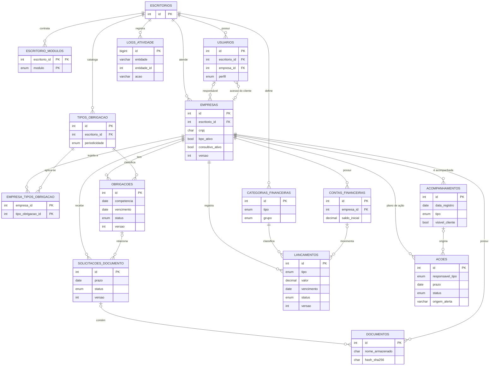

# Banco de dados do -Tributo!

> **Contrato do modelo de dados.** As tarefas copiam as definições deste documento para
> `database/schema/NN_<modulo>.sql`. Qualquer mudança exige aprovação, atualização deste
> documento e registro em [DECISIONS.md](DECISIONS.md).
> Situação: **planejado, não implementado.** O repositório ainda não contém nenhum arquivo `.sql`
> nem a ferramenta `bin/db.php`; `database/schema/` e `database/seeds/` têm apenas `.gitkeep`.
> O DDL abaixo é uma **especificação**. Ver [§8](#8-situação-da-implementação-e-da-validação).

## 1. Princípios

1. **Compatibilidade:** MariaDB 10.4 (XAMPP) e MySQL 8.0.16+ (hospedagem). Nada de recursos exclusivos de um deles.
2. **InnoDB, `utf8mb4` e `utf8mb4_unicode_ci`** declarados em **cada tabela** (a hospedagem pode ter outro padrão).
3. **Multi-tenant:** toda tabela de negócio tem `escritorio_id`. Cada tabela referenciável tem `UNIQUE (id, escritorio_id)` e as FKs são **compostas** `(x_id, escritorio_id)`.
4. **Sem `ON DELETE SET NULL` em FK composta** (anularia o `escritorio_id`). Política padrão: RESTRICT (padrão do InnoDB) + inativação. `CASCADE` só em tabelas de vínculo.
5. **Concorrência otimista:** coluna `versao` nas entidades editáveis por mais de uma pessoa.
6. **Situações derivadas** (atrasada, vencida) **não são gravadas**: são calculadas na consulta (ver [ARCHITECTURE.md §10.1](ARCHITECTURE.md#101-situações-derivadas-nunca-gravadas)).
7. **Dinheiro:** `DECIMAL(15,2)`. **Datas de competência:** `DATE` sempre no dia 01.
8. **Arquivos SQL sem `CREATE DATABASE` nem `USE`**: o banco é criado por `bin/db.php` (local) ou pelo painel da hospedagem.
9. Nomes de tabelas e colunas em português, minúsculas, `snake_case`, sem acento.

## 2. Diagrama entidade-relacionamento



## 3. Arquivos e ordem de execução

| Arquivo | Tabelas | Tarefa |
|---------|---------|--------|
| `database/schema/01_nucleo.sql` | escritorios, escritorio_modulos, usuarios, empresas, logs_atividade, tentativas_login | F02 |
| `database/schema/02_fiscal.sql` | tipos_obrigacao, empresa_tipos_obrigacao, obrigacoes | FI01 |
| `database/schema/03_documentos.sql` | solicitacoes_documento, documentos | DO01 |
| `database/schema/04_financeiro.sql` | categorias_financeiras, contas_financeiras, lancamentos | FN01 |
| `database/schema/05_consultivo.sql` | acompanhamentos, acoes | CO01 |
| `database/seeds/NN_*.sql` | dados fictícios do módulo correspondente | mesma tarefa |
| `database/tributo.sql` | **gerado** por `php bin/db.php build` (nunca editar à mão) | F02 + cada tarefa de schema |

## 4. Definições (DDL)

### 4.1 `01_nucleo.sql`

```sql
CREATE TABLE escritorios (
  id             INT UNSIGNED AUTO_INCREMENT PRIMARY KEY,
  nome           VARCHAR(150) NOT NULL,
  cnpj           CHAR(14)     NULL,
  email          VARCHAR(150) NOT NULL,
  ativo          TINYINT(1)   NOT NULL DEFAULT 1,
  criado_em      DATETIME     NOT NULL DEFAULT CURRENT_TIMESTAMP,
  atualizado_em  DATETIME     NOT NULL DEFAULT CURRENT_TIMESTAMP ON UPDATE CURRENT_TIMESTAMP,
  CONSTRAINT uq_escritorios_cnpj UNIQUE (cnpj)
) ENGINE=InnoDB DEFAULT CHARSET=utf8mb4 COLLATE=utf8mb4_unicode_ci;

-- Módulos contratáveis. O Plano Base não é registrado aqui (sempre ativo).
CREATE TABLE escritorio_modulos (
  escritorio_id  INT UNSIGNED NOT NULL,
  modulo         ENUM('BPO_FINANCEIRO','CONSULTIVO') NOT NULL,
  ativo          TINYINT(1) NOT NULL DEFAULT 1,
  ativado_em     DATETIME   NOT NULL DEFAULT CURRENT_TIMESTAMP,
  PRIMARY KEY (escritorio_id, modulo),
  CONSTRAINT fk_escmod_escritorio FOREIGN KEY (escritorio_id)
      REFERENCES escritorios(id) ON DELETE CASCADE
) ENGINE=InnoDB DEFAULT CHARSET=utf8mb4 COLLATE=utf8mb4_unicode_ci;

-- A FK usuarios.empresa_id é criada depois de `empresas` (dependência circular).
CREATE TABLE usuarios (
  id               INT UNSIGNED AUTO_INCREMENT PRIMARY KEY,
  escritorio_id    INT UNSIGNED NOT NULL,
  empresa_id       INT UNSIGNED NULL,
  nome             VARCHAR(120) NOT NULL,
  email            VARCHAR(150) NOT NULL,
  senha_hash       VARCHAR(255) NOT NULL,
  perfil           ENUM('ADMIN','COLABORADOR','CLIENTE') NOT NULL,
  ativo            TINYINT(1)   NOT NULL DEFAULT 1,
  ultimo_login_em  DATETIME     NULL,
  criado_em        DATETIME     NOT NULL DEFAULT CURRENT_TIMESTAMP,
  atualizado_em    DATETIME     NOT NULL DEFAULT CURRENT_TIMESTAMP ON UPDATE CURRENT_TIMESTAMP,
  CONSTRAINT uq_usuarios_email  UNIQUE (email),
  CONSTRAINT uq_usuarios_tenant UNIQUE (id, escritorio_id),
  CONSTRAINT fk_usuarios_escritorio FOREIGN KEY (escritorio_id) REFERENCES escritorios(id),
  CONSTRAINT ck_usuarios_cliente_empresa CHECK (
    (perfil = 'CLIENTE' AND empresa_id IS NOT NULL) OR
    (perfil <> 'CLIENTE' AND empresa_id IS NULL)
  ),
  INDEX idx_usuarios_lista (escritorio_id, perfil, ativo, nome)
) ENGINE=InnoDB DEFAULT CHARSET=utf8mb4 COLLATE=utf8mb4_unicode_ci;

CREATE TABLE empresas (
  id                 INT UNSIGNED AUTO_INCREMENT PRIMARY KEY,
  escritorio_id      INT UNSIGNED NOT NULL,
  razao_social       VARCHAR(150) NOT NULL,
  nome_fantasia      VARCHAR(150) NULL,
  cnpj               CHAR(14)     NOT NULL,   -- sem máscara, maiúsculas; aceita formato alfanumérico
  regime_tributario  ENUM('MEI','SIMPLES_NACIONAL','LUCRO_PRESUMIDO','LUCRO_REAL') NOT NULL, -- informativo
  segmento           VARCHAR(80)  NULL,       -- texto livre (comércio, serviços...), informativo
  contato_nome       VARCHAR(120) NULL,
  email              VARCHAR(150) NULL,
  telefone           VARCHAR(20)  NULL,
  responsavel_id     INT UNSIGNED NULL,
  bpo_ativo          TINYINT(1)   NOT NULL DEFAULT 0,  -- escritório vende BPO a esta empresa
  consultivo_ativo   TINYINT(1)   NOT NULL DEFAULT 0,  -- escritório vende consultoria a esta empresa
  status             ENUM('ATIVA','INATIVA') NOT NULL DEFAULT 'ATIVA',
  observacoes        TEXT NULL,
  versao             INT UNSIGNED NOT NULL DEFAULT 1,
  criado_em          DATETIME NOT NULL DEFAULT CURRENT_TIMESTAMP,
  atualizado_em      DATETIME NOT NULL DEFAULT CURRENT_TIMESTAMP ON UPDATE CURRENT_TIMESTAMP,
  CONSTRAINT uq_empresas_tenant UNIQUE (id, escritorio_id),
  CONSTRAINT uq_empresas_cnpj_por_escritorio UNIQUE (escritorio_id, cnpj),
  CONSTRAINT fk_empresas_escritorio  FOREIGN KEY (escritorio_id) REFERENCES escritorios(id),
  CONSTRAINT fk_empresas_responsavel FOREIGN KEY (responsavel_id, escritorio_id)
      REFERENCES usuarios(id, escritorio_id),
  INDEX idx_empresas_busca (escritorio_id, status, razao_social),
  INDEX idx_empresas_responsavel (escritorio_id, responsavel_id)
) ENGINE=InnoDB DEFAULT CHARSET=utf8mb4 COLLATE=utf8mb4_unicode_ci;

ALTER TABLE usuarios
  ADD CONSTRAINT fk_usuarios_empresa FOREIGN KEY (empresa_id, escritorio_id)
      REFERENCES empresas(id, escritorio_id);

-- Auditoria polimórfica (sem FK para a entidade auditada)
CREATE TABLE logs_atividade (
  id             BIGINT UNSIGNED AUTO_INCREMENT PRIMARY KEY,
  escritorio_id  INT UNSIGNED NOT NULL,
  usuario_id     INT UNSIGNED NULL,
  entidade       VARCHAR(50)  NOT NULL,   -- ex.: 'obrigacao', 'lancamento'
  entidade_id    INT UNSIGNED NOT NULL,
  acao           VARCHAR(50)  NOT NULL,   -- ex.: 'criar', 'status:ENTREGUE', 'baixar', 'estornar'
  detalhes       JSON NULL,
  ip             VARCHAR(45)  NULL,
  criado_em      DATETIME NOT NULL DEFAULT CURRENT_TIMESTAMP,
  CONSTRAINT fk_log_escritorio FOREIGN KEY (escritorio_id) REFERENCES escritorios(id),
  CONSTRAINT fk_log_usuario    FOREIGN KEY (usuario_id, escritorio_id)
      REFERENCES usuarios(id, escritorio_id),
  INDEX idx_log_entidade (escritorio_id, entidade, entidade_id, criado_em)
) ENGINE=InnoDB DEFAULT CHARSET=utf8mb4 COLLATE=utf8mb4_unicode_ci;

CREATE TABLE tentativas_login (
  id         BIGINT UNSIGNED AUTO_INCREMENT PRIMARY KEY,
  email      VARCHAR(150) NOT NULL,
  ip         VARCHAR(45)  NOT NULL,
  sucesso    TINYINT(1)   NOT NULL,
  criado_em  DATETIME     NOT NULL DEFAULT CURRENT_TIMESTAMP,
  INDEX idx_tl_email (email, criado_em),
  INDEX idx_tl_ip    (ip, criado_em)
) ENGINE=InnoDB DEFAULT CHARSET=utf8mb4 COLLATE=utf8mb4_unicode_ci;
```

### 4.2 `02_fiscal.sql`

```sql
CREATE TABLE tipos_obrigacao (
  id                      INT UNSIGNED AUTO_INCREMENT PRIMARY KEY,
  escritorio_id           INT UNSIGNED NOT NULL,
  nome                    VARCHAR(100) NOT NULL,
  descricao               VARCHAR(255) NULL,
  esfera                  ENUM('FEDERAL','ESTADUAL','MUNICIPAL','TRABALHISTA','OUTRA') NOT NULL,
  periodicidade           ENUM('MENSAL','TRIMESTRAL','ANUAL','EVENTUAL') NOT NULL,
  dia_vencimento          TINYINT UNSIGNED NULL,
  meses_apos_competencia  TINYINT UNSIGNED NOT NULL DEFAULT 1,
  ativo                   TINYINT(1) NOT NULL DEFAULT 1,
  criado_em               DATETIME NOT NULL DEFAULT CURRENT_TIMESTAMP,
  atualizado_em           DATETIME NOT NULL DEFAULT CURRENT_TIMESTAMP ON UPDATE CURRENT_TIMESTAMP,
  CONSTRAINT uq_tipos_tenant UNIQUE (id, escritorio_id),
  CONSTRAINT uq_tipos_nome   UNIQUE (escritorio_id, nome),
  CONSTRAINT fk_tipos_escritorio FOREIGN KEY (escritorio_id) REFERENCES escritorios(id),
  CONSTRAINT ck_tipos_dia    CHECK (dia_vencimento IS NULL OR dia_vencimento BETWEEN 1 AND 31),
  CONSTRAINT ck_tipos_meses  CHECK (meses_apos_competencia BETWEEN 0 AND 12),
  CONSTRAINT ck_tipos_dia_obrigatorio CHECK (
    periodicidade IN ('ANUAL','EVENTUAL') OR dia_vencimento IS NOT NULL
  )
) ENGINE=InnoDB DEFAULT CHARSET=utf8mb4 COLLATE=utf8mb4_unicode_ci;

-- Quais tipos se aplicam a cada empresa (decisão do contador, não do sistema)
CREATE TABLE empresa_tipos_obrigacao (
  empresa_id             INT UNSIGNED NOT NULL,
  tipo_obrigacao_id      INT UNSIGNED NOT NULL,
  escritorio_id          INT UNSIGNED NOT NULL,
  responsavel_padrao_id  INT UNSIGNED NULL,
  criado_em              DATETIME NOT NULL DEFAULT CURRENT_TIMESTAMP,
  PRIMARY KEY (empresa_id, tipo_obrigacao_id),
  CONSTRAINT fk_eto_empresa FOREIGN KEY (empresa_id, escritorio_id)
      REFERENCES empresas(id, escritorio_id) ON DELETE CASCADE,
  CONSTRAINT fk_eto_tipo FOREIGN KEY (tipo_obrigacao_id, escritorio_id)
      REFERENCES tipos_obrigacao(id, escritorio_id) ON DELETE CASCADE,
  CONSTRAINT fk_eto_responsavel FOREIGN KEY (responsavel_padrao_id, escritorio_id)
      REFERENCES usuarios(id, escritorio_id),
  INDEX idx_eto_tipo (escritorio_id, tipo_obrigacao_id)
) ENGINE=InnoDB DEFAULT CHARSET=utf8mb4 COLLATE=utf8mb4_unicode_ci;

CREATE TABLE obrigacoes (
  id                 INT UNSIGNED AUTO_INCREMENT PRIMARY KEY,
  escritorio_id      INT UNSIGNED NOT NULL,
  empresa_id         INT UNSIGNED NOT NULL,
  tipo_obrigacao_id  INT UNSIGNED NOT NULL,
  competencia        DATE NOT NULL,                 -- sempre dia 01
  vencimento         DATE NOT NULL,
  status             ENUM('PENDENTE','EM_ANDAMENTO','AGUARDANDO_CLIENTE','ENTREGUE','DISPENSADA')
                     NOT NULL DEFAULT 'PENDENTE',
  responsavel_id     INT UNSIGNED NULL,
  entregue_em        DATETIME NULL,
  entregue_por       INT UNSIGNED NULL,
  protocolo          VARCHAR(100) NULL,             -- número do recibo, informado manualmente
  observacao         TEXT NULL,                     -- interna; nunca exibida ao cliente
  versao             INT UNSIGNED NOT NULL DEFAULT 1,
  criado_por         INT UNSIGNED NOT NULL,
  criado_em          DATETIME NOT NULL DEFAULT CURRENT_TIMESTAMP,
  atualizado_em      DATETIME NOT NULL DEFAULT CURRENT_TIMESTAMP ON UPDATE CURRENT_TIMESTAMP,
  CONSTRAINT uq_obr_tenant      UNIQUE (id, escritorio_id),
  CONSTRAINT uq_obr_competencia UNIQUE (empresa_id, tipo_obrigacao_id, competencia),
  CONSTRAINT fk_obr_escritorio  FOREIGN KEY (escritorio_id) REFERENCES escritorios(id),
  CONSTRAINT fk_obr_empresa     FOREIGN KEY (empresa_id, escritorio_id)
      REFERENCES empresas(id, escritorio_id),
  CONSTRAINT fk_obr_tipo        FOREIGN KEY (tipo_obrigacao_id, escritorio_id)
      REFERENCES tipos_obrigacao(id, escritorio_id),
  CONSTRAINT fk_obr_responsavel FOREIGN KEY (responsavel_id, escritorio_id)
      REFERENCES usuarios(id, escritorio_id),
  CONSTRAINT fk_obr_entregue_por FOREIGN KEY (entregue_por, escritorio_id)
      REFERENCES usuarios(id, escritorio_id),
  CONSTRAINT fk_obr_criado_por  FOREIGN KEY (criado_por, escritorio_id)
      REFERENCES usuarios(id, escritorio_id),
  CONSTRAINT ck_obr_competencia CHECK (DAYOFMONTH(competencia) = 1),
  CONSTRAINT ck_obr_vencimento  CHECK (vencimento >= competencia),
  CONSTRAINT ck_obr_entrega CHECK (
    (status = 'ENTREGUE' AND entregue_em IS NOT NULL AND entregue_por IS NOT NULL) OR
    (status <> 'ENTREGUE' AND entregue_em IS NULL AND entregue_por IS NULL)
  ),
  INDEX idx_obr_painel      (escritorio_id, status, vencimento),
  INDEX idx_obr_empresa     (escritorio_id, empresa_id, vencimento),
  INDEX idx_obr_responsavel (escritorio_id, responsavel_id, status, vencimento)
) ENGINE=InnoDB DEFAULT CHARSET=utf8mb4 COLLATE=utf8mb4_unicode_ci;
```

### 4.3 `03_documentos.sql`

```sql
CREATE TABLE solicitacoes_documento (
  id             INT UNSIGNED AUTO_INCREMENT PRIMARY KEY,
  escritorio_id  INT UNSIGNED NOT NULL,
  empresa_id     INT UNSIGNED NOT NULL,
  obrigacao_id   INT UNSIGNED NULL,
  titulo         VARCHAR(150) NOT NULL,
  descricao      TEXT NULL,
  prazo          DATE NOT NULL,
  status         ENUM('ABERTA','ENVIADA','ACEITA','RECUSADA','CANCELADA') NOT NULL DEFAULT 'ABERTA',
  motivo_recusa  VARCHAR(255) NULL,
  respondida_em  DATETIME NULL,                     -- primeiro envio do cliente
  versao         INT UNSIGNED NOT NULL DEFAULT 1,
  criado_por     INT UNSIGNED NOT NULL,
  criado_em      DATETIME NOT NULL DEFAULT CURRENT_TIMESTAMP,
  atualizado_em  DATETIME NOT NULL DEFAULT CURRENT_TIMESTAMP ON UPDATE CURRENT_TIMESTAMP,
  CONSTRAINT uq_sol_tenant UNIQUE (id, escritorio_id),
  CONSTRAINT fk_sol_escritorio FOREIGN KEY (escritorio_id) REFERENCES escritorios(id),
  CONSTRAINT fk_sol_empresa    FOREIGN KEY (empresa_id, escritorio_id)
      REFERENCES empresas(id, escritorio_id),
  CONSTRAINT fk_sol_obrigacao  FOREIGN KEY (obrigacao_id, escritorio_id)
      REFERENCES obrigacoes(id, escritorio_id),
  CONSTRAINT fk_sol_criado_por FOREIGN KEY (criado_por, escritorio_id)
      REFERENCES usuarios(id, escritorio_id),
  CONSTRAINT ck_sol_recusa CHECK (status <> 'RECUSADA' OR motivo_recusa IS NOT NULL),
  INDEX idx_sol_painel  (escritorio_id, status, prazo),
  INDEX idx_sol_empresa (escritorio_id, empresa_id, status, prazo)
) ENGINE=InnoDB DEFAULT CHARSET=utf8mb4 COLLATE=utf8mb4_unicode_ci;

CREATE TABLE documentos (
  id               INT UNSIGNED AUTO_INCREMENT PRIMARY KEY,
  escritorio_id    INT UNSIGNED NOT NULL,
  empresa_id       INT UNSIGNED NOT NULL,
  solicitacao_id   INT UNSIGNED NULL,
  nome_original    VARCHAR(255) NOT NULL,
  nome_armazenado  VARCHAR(40)  NOT NULL,           -- 32 hex aleatórios + '.' + extensão
  mime_type        VARCHAR(100) NOT NULL,
  tamanho_bytes    INT UNSIGNED NOT NULL,
  hash_sha256      CHAR(64)     NOT NULL,
  enviado_por      INT UNSIGNED NOT NULL,
  criado_em        DATETIME NOT NULL DEFAULT CURRENT_TIMESTAMP,
  CONSTRAINT uq_doc_armazenado UNIQUE (nome_armazenado),
  CONSTRAINT fk_doc_escritorio  FOREIGN KEY (escritorio_id) REFERENCES escritorios(id),
  CONSTRAINT fk_doc_empresa     FOREIGN KEY (empresa_id, escritorio_id)
      REFERENCES empresas(id, escritorio_id),
  CONSTRAINT fk_doc_solicitacao FOREIGN KEY (solicitacao_id, escritorio_id)
      REFERENCES solicitacoes_documento(id, escritorio_id),
  CONSTRAINT fk_doc_enviado_por FOREIGN KEY (enviado_por, escritorio_id)
      REFERENCES usuarios(id, escritorio_id),
  CONSTRAINT ck_doc_tamanho CHECK (tamanho_bytes BETWEEN 1 AND 10485760),
  INDEX idx_doc_empresa (escritorio_id, empresa_id, criado_em)
) ENGINE=InnoDB DEFAULT CHARSET=utf8mb4 COLLATE=utf8mb4_unicode_ci;
```

### 4.4 `04_financeiro.sql` (módulo BPO_FINANCEIRO)

```sql
-- Plano de categorias gerenciais do escritório (aplicado a todas as empresas com BPO)
CREATE TABLE categorias_financeiras (
  id             INT UNSIGNED AUTO_INCREMENT PRIMARY KEY,
  escritorio_id  INT UNSIGNED NOT NULL,
  nome           VARCHAR(80) NOT NULL,
  tipo           ENUM('RECEITA','DESPESA') NOT NULL,
  grupo          ENUM('RECEITA_OPERACIONAL','RECEITA_NAO_OPERACIONAL',
                      'CUSTO_DIRETO','DESPESA_OPERACIONAL','PESSOAL','TRIBUTOS',
                      'DESPESA_FINANCEIRA','RETIRADA_SOCIOS','INVESTIMENTO','OUTRAS_DESPESAS') NOT NULL,
  ativo          TINYINT(1) NOT NULL DEFAULT 1,
  criado_em      DATETIME NOT NULL DEFAULT CURRENT_TIMESTAMP,
  atualizado_em  DATETIME NOT NULL DEFAULT CURRENT_TIMESTAMP ON UPDATE CURRENT_TIMESTAMP,
  CONSTRAINT uq_cat_tenant UNIQUE (id, escritorio_id),
  CONSTRAINT uq_cat_nome   UNIQUE (escritorio_id, tipo, nome),
  CONSTRAINT fk_cat_escritorio FOREIGN KEY (escritorio_id) REFERENCES escritorios(id),
  CONSTRAINT ck_cat_grupo CHECK (
    (tipo = 'RECEITA' AND grupo IN ('RECEITA_OPERACIONAL','RECEITA_NAO_OPERACIONAL')) OR
    (tipo = 'DESPESA' AND grupo NOT IN ('RECEITA_OPERACIONAL','RECEITA_NAO_OPERACIONAL'))
  )
) ENGINE=InnoDB DEFAULT CHARSET=utf8mb4 COLLATE=utf8mb4_unicode_ci;

-- Contas bancárias / caixa de cada empresa cliente
CREATE TABLE contas_financeiras (
  id                  INT UNSIGNED AUTO_INCREMENT PRIMARY KEY,
  escritorio_id       INT UNSIGNED NOT NULL,
  empresa_id          INT UNSIGNED NOT NULL,
  nome                VARCHAR(80) NOT NULL,
  tipo                ENUM('CAIXA','CONTA_CORRENTE','POUPANCA','APLICACAO','OUTRA') NOT NULL,
  saldo_inicial       DECIMAL(15,2) NOT NULL DEFAULT 0.00,
  data_saldo_inicial  DATE NOT NULL,
  ativo               TINYINT(1) NOT NULL DEFAULT 1,
  criado_em           DATETIME NOT NULL DEFAULT CURRENT_TIMESTAMP,
  atualizado_em       DATETIME NOT NULL DEFAULT CURRENT_TIMESTAMP ON UPDATE CURRENT_TIMESTAMP,
  CONSTRAINT uq_conta_tenant  UNIQUE (id, escritorio_id),
  CONSTRAINT uq_conta_empresa UNIQUE (id, empresa_id),
  CONSTRAINT uq_conta_nome    UNIQUE (empresa_id, nome),
  CONSTRAINT fk_conta_empresa FOREIGN KEY (empresa_id, escritorio_id)
      REFERENCES empresas(id, escritorio_id),
  INDEX idx_conta_empresa (escritorio_id, empresa_id, ativo)
) ENGINE=InnoDB DEFAULT CHARSET=utf8mb4 COLLATE=utf8mb4_unicode_ci;

-- Contas a pagar (DESPESA) e a receber (RECEITA)
CREATE TABLE lancamentos (
  id              INT UNSIGNED AUTO_INCREMENT PRIMARY KEY,
  escritorio_id   INT UNSIGNED NOT NULL,
  empresa_id      INT UNSIGNED NOT NULL,
  tipo            ENUM('RECEITA','DESPESA') NOT NULL,
  categoria_id    INT UNSIGNED NOT NULL,           -- tipo da categoria = tipo do lançamento (validado no service)
  conta_id        INT UNSIGNED NULL,               -- obrigatória na baixa
  descricao       VARCHAR(150) NOT NULL,
  contraparte     VARCHAR(150) NULL,               -- cliente ou fornecedor (texto livre)
  documento_ref   VARCHAR(60)  NULL,               -- nº de NF, boleto etc. (informativo)
  valor           DECIMAL(15,2) NOT NULL,
  competencia     DATE NOT NULL,                   -- dia 01; base para a futura DRE gerencial
  vencimento      DATE NOT NULL,
  status          ENUM('ABERTO','PAGO','CANCELADO') NOT NULL DEFAULT 'ABERTO',
  pago_em         DATE NULL,
  valor_pago      DECIMAL(15,2) NULL,              -- pode diferir de `valor` (juros/desconto)
  origem          ENUM('ESCRITORIO','CLIENTE') NOT NULL DEFAULT 'ESCRITORIO',
  observacao      TEXT NULL,
  versao          INT UNSIGNED NOT NULL DEFAULT 1,
  criado_por      INT UNSIGNED NOT NULL,
  criado_em       DATETIME NOT NULL DEFAULT CURRENT_TIMESTAMP,
  atualizado_em   DATETIME NOT NULL DEFAULT CURRENT_TIMESTAMP ON UPDATE CURRENT_TIMESTAMP,
  CONSTRAINT uq_lanc_tenant UNIQUE (id, escritorio_id),
  CONSTRAINT fk_lanc_escritorio FOREIGN KEY (escritorio_id) REFERENCES escritorios(id),
  CONSTRAINT fk_lanc_empresa    FOREIGN KEY (empresa_id, escritorio_id)
      REFERENCES empresas(id, escritorio_id),
  CONSTRAINT fk_lanc_categoria  FOREIGN KEY (categoria_id, escritorio_id)
      REFERENCES categorias_financeiras(id, escritorio_id),
  CONSTRAINT fk_lanc_conta      FOREIGN KEY (conta_id, empresa_id)
      REFERENCES contas_financeiras(id, empresa_id),
  CONSTRAINT fk_lanc_criado_por FOREIGN KEY (criado_por, escritorio_id)
      REFERENCES usuarios(id, escritorio_id),
  CONSTRAINT ck_lanc_valor       CHECK (valor > 0),
  CONSTRAINT ck_lanc_competencia CHECK (DAYOFMONTH(competencia) = 1),
  CONSTRAINT ck_lanc_baixa CHECK (
    (status = 'PAGO' AND pago_em IS NOT NULL AND valor_pago IS NOT NULL
                     AND valor_pago > 0 AND conta_id IS NOT NULL) OR
    (status <> 'PAGO' AND pago_em IS NULL AND valor_pago IS NULL)
  ),
  INDEX idx_lanc_vencimento (escritorio_id, empresa_id, status, vencimento),
  INDEX idx_lanc_pagamento  (escritorio_id, empresa_id, pago_em),
  INDEX idx_lanc_categoria  (escritorio_id, empresa_id, categoria_id),
  INDEX idx_lanc_carteira   (escritorio_id, status, vencimento)
) ENGINE=InnoDB DEFAULT CHARSET=utf8mb4 COLLATE=utf8mb4_unicode_ci;
```

### 4.5 `05_consultivo.sql` (módulo CONSULTIVO)

```sql
CREATE TABLE acompanhamentos (
  id               INT UNSIGNED AUTO_INCREMENT PRIMARY KEY,
  escritorio_id    INT UNSIGNED NOT NULL,
  empresa_id       INT UNSIGNED NOT NULL,
  data_registro    DATE NOT NULL,
  tipo             ENUM('REUNIAO','LIGACAO','VISITA','ANALISE','OUTRO') NOT NULL,
  titulo           VARCHAR(150) NOT NULL,
  resumo           TEXT NOT NULL,
  visivel_cliente  TINYINT(1) NOT NULL DEFAULT 0,
  versao           INT UNSIGNED NOT NULL DEFAULT 1,
  criado_por       INT UNSIGNED NOT NULL,
  criado_em        DATETIME NOT NULL DEFAULT CURRENT_TIMESTAMP,
  atualizado_em    DATETIME NOT NULL DEFAULT CURRENT_TIMESTAMP ON UPDATE CURRENT_TIMESTAMP,
  CONSTRAINT uq_acomp_tenant UNIQUE (id, escritorio_id),
  CONSTRAINT fk_acomp_escritorio FOREIGN KEY (escritorio_id) REFERENCES escritorios(id),
  CONSTRAINT fk_acomp_empresa    FOREIGN KEY (empresa_id, escritorio_id)
      REFERENCES empresas(id, escritorio_id),
  CONSTRAINT fk_acomp_criado_por FOREIGN KEY (criado_por, escritorio_id)
      REFERENCES usuarios(id, escritorio_id),
  INDEX idx_acomp_empresa (escritorio_id, empresa_id, data_registro)
) ENGINE=InnoDB DEFAULT CHARSET=utf8mb4 COLLATE=utf8mb4_unicode_ci;

-- Plano de ação
CREATE TABLE acoes (
  id                 INT UNSIGNED AUTO_INCREMENT PRIMARY KEY,
  escritorio_id      INT UNSIGNED NOT NULL,
  empresa_id         INT UNSIGNED NOT NULL,
  acompanhamento_id  INT UNSIGNED NULL,
  titulo             VARCHAR(150) NOT NULL,
  descricao          TEXT NULL,
  responsavel_tipo   ENUM('ESCRITORIO','CLIENTE') NOT NULL,
  responsavel_id     INT UNSIGNED NULL,          -- usuário do escritório, quando ESCRITORIO
  prazo              DATE NULL,
  status             ENUM('ABERTA','EM_ANDAMENTO','CONCLUIDA','CANCELADA') NOT NULL DEFAULT 'ABERTA',
  concluida_em       DATETIME NULL,
  origem_alerta      VARCHAR(40) NULL,           -- código do radar (ex.: 'FIN_RESULTADO_NEGATIVO')
  visivel_cliente    TINYINT(1) NOT NULL DEFAULT 1,
  versao             INT UNSIGNED NOT NULL DEFAULT 1,
  criado_por         INT UNSIGNED NOT NULL,
  criado_em          DATETIME NOT NULL DEFAULT CURRENT_TIMESTAMP,
  atualizado_em      DATETIME NOT NULL DEFAULT CURRENT_TIMESTAMP ON UPDATE CURRENT_TIMESTAMP,
  CONSTRAINT uq_acao_tenant UNIQUE (id, escritorio_id),
  CONSTRAINT fk_acao_escritorio     FOREIGN KEY (escritorio_id) REFERENCES escritorios(id),
  CONSTRAINT fk_acao_empresa        FOREIGN KEY (empresa_id, escritorio_id)
      REFERENCES empresas(id, escritorio_id),
  CONSTRAINT fk_acao_acompanhamento FOREIGN KEY (acompanhamento_id, escritorio_id)
      REFERENCES acompanhamentos(id, escritorio_id),
  CONSTRAINT fk_acao_responsavel    FOREIGN KEY (responsavel_id, escritorio_id)
      REFERENCES usuarios(id, escritorio_id),
  CONSTRAINT fk_acao_criado_por     FOREIGN KEY (criado_por, escritorio_id)
      REFERENCES usuarios(id, escritorio_id),
  CONSTRAINT ck_acao_responsavel CHECK (responsavel_tipo = 'ESCRITORIO' OR responsavel_id IS NULL),
  CONSTRAINT ck_acao_conclusao CHECK (
    (status = 'CONCLUIDA' AND concluida_em IS NOT NULL) OR
    (status <> 'CONCLUIDA' AND concluida_em IS NULL)
  ),
  INDEX idx_acao_painel  (escritorio_id, status, prazo),
  INDEX idx_acao_empresa (escritorio_id, empresa_id, status)
) ENGINE=InnoDB DEFAULT CHARSET=utf8mb4 COLLATE=utf8mb4_unicode_ci;
```

## 5. Notas técnicas

- **FK composta com coluna nula:** no InnoDB, se qualquer coluna da FK for `NULL`, a restrição não é verificada (MATCH SIMPLE). É o comportamento desejado para `responsavel_id`, `obrigacao_id` e `conta_id` opcionais.
- **CHECK + FK:** o MySQL 8 proíbe ações referenciais (`CASCADE`, `SET NULL`) em colunas usadas em CHECK. Por isso essas FKs usam o padrão (RESTRICT).
- **`DAYOFMONTH()` em CHECK:** função determinística, aceita pelo MariaDB 10.4 e pelo MySQL 8.
- **JSON no MariaDB 10.4:** é um alias de `LONGTEXT` com validação; consultas usam apenas leitura simples.
- **Por que `lancamentos.conta_id` referencia `(id, empresa_id)`:** garante que a conta pertence à **mesma empresa** do lançamento, não só ao mesmo escritório.
- **Hospedagem com MySQL < 8.0.16:** os CHECKs seriam ignorados silenciosamente. A validação no service continua garantindo as regras; confirme a versão na tarefa Q02.

## 6. Índices: justificativa

| Índice | Consulta atendida |
|--------|-------------------|
| `idx_empresas_busca` | Listagem de empresas por status, ordenada por razão social |
| `idx_obr_painel` | Painel: atrasadas e vencendo, por status e vencimento |
| `idx_obr_empresa` | Obrigações de uma empresa (aba, Índice) |
| `idx_obr_responsavel` | Filtro "minhas obrigações" |
| `idx_sol_painel` / `idx_sol_empresa` | Pendências documentais por status e prazo |
| `idx_lanc_vencimento` | Contas a pagar e a receber da empresa; projeção do fluxo |
| `idx_lanc_pagamento` | Fluxo realizado e indicadores mensais |
| `idx_lanc_carteira` | Visão BPO da carteira (todas as empresas) |
| `idx_acao_painel` | Ações atrasadas no painel e no radar |
| `idx_log_entidade` | Histórico de um registro |
| `idx_tl_email` / `idx_tl_ip` | Controle de força bruta |

## 7. Dados de demonstração (seeds)

| Dado | Conteúdo |
|------|----------|
| Escritórios | **Exemplo Contábil** (todos os módulos) e **Modelo Assessoria** (somente o Plano Base, para demonstrar "módulo não contratado" e o isolamento) |
| Usuários (senha `Senha@123`, somente demonstração) | Exemplo Contábil: `admin@exemplo.test`, `ana@exemplo.test` e `bruno@exemplo.test` (colaboradores), `cliente.padaria@exemplo.test`, `cliente.oficina@exemplo.test`. Modelo Assessoria: `admin@modelo.test`, `cliente@modelo.test` |
| Empresas | ~12 no Exemplo Contábil (MEI, Simples, Presumido; algumas com BPO e consultivo ativos), ~3 no Modelo Assessoria. CNPJs fictícios com dígito verificador válido |
| Fiscal | ~8 tipos de obrigação **marcados como exemplo** ("confira o prazo vigente na fonte oficial"); 6 meses de histórico com entregas no prazo, atrasadas e abertas (para o Índice variar entre verde, amarelo e vermelho) |
| Documentos | Solicitações em todos os status; **sem arquivos reais** (os metadados apontam para PDFs de exemplo gerados no seed local) |
| Financeiro | Categorias padrão; 2 contas por empresa com BPO; ~6 meses de lançamentos, incluindo um cenário de resultado negativo e um de concentração de receita (para disparar o radar) |
| Consultivo | Acompanhamentos e ações em vários status |

Os hashes de senha são gerados uma vez com `password_hash('Senha@123', PASSWORD_DEFAULT)` e gravados no seed.

## 8. Situação da implementação e da validação

### 8.1 O que existe no repositório

| Item | Situação |
|------|----------|
| `database/schema/*.sql` | **Não existe.** Criado nas tarefas F03, FI01, DO01, FN01 e CO01 |
| `database/seeds/*.sql` | **Não existe.** Criado nas mesmas tarefas |
| `database/tributo.sql` | **Não existe.** Gerado a partir da F03 |
| `bin/db.php` (rebuild/build) | **Não existe.** Criado na F03 |
| Testes automatizados de banco | **Não existem.** O único teste atual é `tests/Unit/AmbienteTest.php` (versão do PHP, extensões e autoload) |

### 8.2 Verificação manual feita durante a T00 (não versionada, não reproduzível pelo repositório)

Para reduzir o risco de especificar um DDL incompatível com o XAMPP, foi feita **uma verificação pontual de viabilidade** do texto deste documento:

1. Os blocos SQL das seções 4.1 a 4.5 **deste arquivo** foram extraídos para um arquivo temporário **fora do projeto** (pasta temporária da sessão de trabalho).
2. Foi iniciada uma **instância temporária e separada** do MariaDB 10.4.32 do XAMPP (diretório de dados próprio na pasta temporária, porta 3399). O MySQL do XAMPP e seus bancos **não foram usados nem alterados**.
3. O DDL foi executado em um banco descartável (`ddl_check`): as 16 tabelas foram criadas sem erro.
4. Com 2 escritórios, 2 usuários, 3 empresas, 1 tipo de obrigação, 1 categoria e 2 contas inseridos manualmente, foram executados **14 comandos SQL manuais**, digitados no terminal. As 2 inserções válidas foram aceitas, e as 12 inválidas foram rejeitadas pelo banco:
   - **Núcleo:** obrigação com empresa de outro escritório (FK composta); responsável de outro escritório; usuário CLIENTE sem empresa (CHECK); CLIENTE com empresa de outro escritório.
   - **Fiscal:** competência fora do dia 01; status ENTREGUE sem `entregue_em`; obrigação duplicada na mesma competência; exclusão de empresa com registros vinculados.
   - **Financeiro:** baixa com conta de outra empresa; baixa sem conta; valor zero; categoria de receita com grupo de despesa.
5. A instância foi desligada. **Nenhum arquivo, script ou teste resultante foi adicionado ao repositório.**

**O que essa verificação significa:** o DDL **especificado** é aceito pelo MariaDB 10.4.32 e as restrições de isolamento se comportam como projetado.
**O que ela não significa:** que o banco esteja implementado ou entregue, ou que exista um teste automatizado. A compatibilidade com o MySQL 8 também **não** foi verificada.

### 8.3 Como a verificação será incorporada de verdade

As mesmas verificações passam a ser **testes automatizados versionados** nos cartões das tarefas de schema: F03 (núcleo), FI01 (fiscal) e FN01 (financeiro). Ao copiar o DDL para `database/schema/`, a tarefa deve executá-lo no MariaDB do XAMPP com `php bin/db.php rebuild`. Qualquer divergência encontrada é corrigida neste documento antes do merge.
