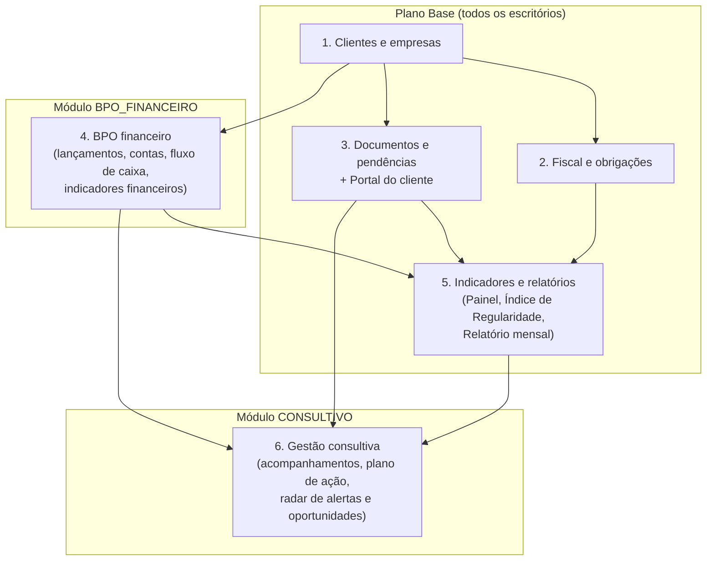

# Tributo: visão de produto e visão comercial

> Documento de produto. Descreve **o que o Tributo pretende ser**, e não o que já está pronto.
> A situação de cada funcionalidade está em [ROADMAP.md](ROADMAP.md).

## 1. Problema

Escritórios contábeis de pequeno e médio porte operam com:

- **Obrigações e prazos** controlados em planilhas e na memória da equipe.
- **Documentos e pendências** cobrados pelo WhatsApp e por e-mail, sem prazo, status nem histórico.
- **Pouca visibilidade financeira dos clientes**: o escritório recebe os dados tarde e desorganizados, e não consegue orientar.
- **Serviço percebido como commodity**: o cliente vê o contador como custo obrigatório, não como parceiro de gestão.

O resultado é risco de atraso, retrabalho operacional, honorários pressionados e oportunidades de consultoria perdidas.

## 2. Proposta de valor

> **O Tributo transforma o escritório contábil em parceiro de gestão.** Ele organiza obrigações e pendências documentais em um só lugar e dá ao cliente um portal simples. Com isso, o escritório pode oferecer **BPO financeiro** e **acompanhamento consultivo** baseados em dados, criando novas receitas recorrentes.

Público-alvo:

| Segmento | Papel no produto |
|----------|------------------|
| Escritórios de contabilidade pequenos e médios | **Comprador** (sócio/titular) e usuários internos |
| Contadores autônomos | Comprador em plano de entrada |
| Clientes do escritório (MEI, ME, EPP) | **Usuários do portal**. Não pagam diretamente: o custo entra nos honorários ou no serviço de BPO |

## 3. Mapa de módulos

O produto é organizado em **seis áreas funcionais**, agrupadas em **um plano base e dois módulos contratáveis**:

| # | Área | O que resolve | Quem usa |
|---|------|---------------|----------|
| 1 | **Clientes e empresas** | Cadastro da carteira, responsáveis, serviços contratados por cliente (BPO e consultivo) | Escritório |
| 2 | **Fiscal e obrigações** | Catálogo de obrigações do escritório, geração por competência, status, entregas, histórico, calendário | Escritório; cliente vê |
| 3 | **Documentos e pendências** | Solicitação formal de documentos com prazo, upload pelo cliente, aceite ou recusa, histórico | Escritório e cliente |
| 4 | **BPO financeiro** | Contas a pagar e a receber dos clientes, baixas, categorias gerenciais, contas e caixa, fluxo de caixa realizado e projetado | Escritório (operador BPO); cliente vê |
| 5 | **Indicadores e relatórios** | Painel da carteira, Índice de Regularidade, painel 360º da empresa, indicadores financeiros, relatório mensal para o cliente | Escritório; cliente recebe o relatório |
| 6 | **Gestão consultiva** | Registro de reuniões e atendimentos, plano de ação com responsáveis, radar de alertas que sugere oportunidades de consultoria | Escritório; cliente vê as ações dele |

## 4. Funcionalidades inovadoras

1. **Índice de Regularidade (base):** nota de 0 a 100 com semáforo e motivos explicados, calculada a partir da pontualidade nas obrigações e das pendências documentais.
2. **Radar de Alertas e Oportunidades (Consultivo):** regras transparentes sobre os dados registrados, por exemplo "resultado de caixa negativo em 2 dos últimos 3 meses" ou "mais de 50% da receita vem de um único cliente". Cada alerta sugere uma conversa consultiva e **vira uma ação do plano com um clique**.
3. **Relatório mensal do cliente:** página imprimível que reúne regularidade, pendências, resumo financeiro e plano de ação. É o "entregável" que o escritório leva para a reunião com o cliente.

> **Limite deliberado:** índices, alertas e relatórios são **gerenciais e administrativos**, baseados apenas nos registros do próprio escritório. O sistema **não calcula tributos, não determina quais obrigações uma empresa deve cumprir e não atesta regularidade fiscal**. Toda tela que mostra esses dados exibe esse aviso.

## 5. Avaliação de viabilidade por funcionalidade

Legenda de prioridade na primeira entrega (≈ 7 dias): **M** = obrigatória (Must, núcleo); **S** = planejada (Should): entra na entrega conforme a ordem de inclusão e a velocidade medida, senão vai para a continuação R1.1; **C** = só com folga (Could); **F** = versão futura.

| Área | Funcionalidade | Complexidade | Depende de | Prioridade |
|------|----------------|:------------:|------------|:----------:|
| Fundação | Login, sessões, perfis, isolamento por escritório, segurança | Média | — | **M** |
| Fundação | Módulos contratáveis por escritório | Baixa | Fundação | **M** |
| 1 | CRUD de empresas com busca, filtros e paginação | Baixa | Fundação | **M** |
| 1 | Gestão de usuários (admin) | Baixa | Empresas | S (usuários de demonstração vêm do seed) |
| 1 | Página "Plano e módulos" do escritório | Baixa | Fundação | C |
| 2 | Catálogo de tipos de obrigação + vínculo com empresas | Baixa | Empresas | **M** |
| 2 | CRUD de obrigações com filtros | Média | Tipos | **M** |
| 2 | Fluxo de status e histórico de entregas | Média | Obrigações | **M** |
| 2 | Gerador de obrigações por competência | Média | Obrigações | S (primeira inclusão) |
| 2 | Calendário mensal de vencimentos | Baixa | Obrigações | C |
| 3 | Solicitações de documento (lado do escritório) | Média | Empresas, Obrigações | S |
| 3 | Upload e download seguros | Média/alta (segurança) | Solicitações | S |
| 3 | Portal do cliente | Média | Upload | S |
| 4 | Categorias gerenciais e contas/caixa | Baixa | Empresas | S |
| 4 | Lançamentos (a pagar e a receber) com filtros | Média | Categorias | S |
| 4 | Baixa, estorno e cancelamento | Média | Lançamentos | S |
| 4 | Fluxo de caixa e indicadores financeiros | Média | Baixas | S |
| 4 | Visão da carteira BPO (vencimentos de todos os clientes) | Baixa | Lançamentos | C |
| 4 | Financeiro no portal do cliente (somente leitura) | Baixa | Portal, Indicadores | C |
| 5 | Índice de Regularidade | Média | Obrigações (Documentos opcional) | **M** |
| 5 | Painel do escritório (indicadores da carteira) | Média | Índice | **M** |
| 5 | Painel 360º da empresa | Baixa | Painel | S |
| 5 | Relatório mensal imprimível | Média | Indicadores | S |
| 6 | Acompanhamentos (reuniões e atendimentos) | Baixa | Empresas | S |
| 6 | Plano de ação | Baixa | Acompanhamentos | S |
| 6 | Radar de alertas + "criar ação a partir do alerta" | Média | Indicadores fiscais e financeiros | S |
| 6 | Radar da carteira (todas as empresas) | Baixa | Radar | C |
| — | Lembretes por e-mail (cron) | Média | Documentos | F (v1.1) |
| — | Lançamentos recorrentes e parcelados | Média | Lançamentos | F (v1.1) |
| — | Cliente registra despesas e comprovantes pelo portal | Média | Portal, Lançamentos | F (v1.1) |
| — | Exportação CSV e PDF | Baixa | Relatórios | F (v1.1) |
| — | Importação de extrato OFX e conciliação bancária | Alta | Lançamentos | F (v1.2) |
| — | DRE gerencial por competência e orçamento × realizado | Média | Lançamentos | F (v1.2) |
| — | Importação de XML de NF-e (somente leitura, para faturamento) | Alta | Financeiro | F (v2) |
| — | Gestão de honorários e contratos do próprio escritório | Média | Cadastros | F (v2) |
| — | Cadastro self-service, período de teste, cobrança da assinatura | Alta | Tudo | F (v2) |
| — | Integrações com órgãos públicos, bancos e sistemas contábeis | Muito alta | Análise jurídica e técnica | F (v3) |
| — | IA (resumos, classificação automática de lançamentos) | Alta | Base de dados madura | F (v3) |
| — | Aplicativo móvel | Alta | API | F (v3) |

**Leitura do quadro (revisão 2):** o **produto** contempla as seis áreas, todas especificadas e com cartões de implementação prontos. A **entrega acadêmica** garante o núcleo (Fundação, Empresas, Fiscal essencial, Índice de Regularidade e Painel), estimado em cerca de 6 dias considerando o tempo de revisar e entender o código. Documentos, BPO e Consultivo entram **um bloco por vez**, conforme a velocidade medida nos primeiros dias (ver [ROADMAP.md §4](ROADMAP.md#4-núcleo-obrigatório-e-ordem-de-inclusão)). O que não couber segue para a continuação R1.1 **sem sair do plano**, e é apresentado como roadmap, nunca como funcionalidade pronta.

## 6. Releases

| Release | Objetivo | Conteúdo |
|---------|----------|----------|
| **R1: Entrega acadêmica** (≈ 7 dias) | Demonstrar o núcleo com qualidade e segurança, e a visão completa como roadmap | **Garantido:** Fundação, Empresas, Fiscal essencial, Índice, Painel, suíte de segurança, teste com usuário real e 2 melhorias. **Conforme a velocidade:** gerador de competência, Documentos/Portal, BPO essencial, Consultivo essencial, Relatório. **Condicional:** publicação em hospedagem |
| **R1.1: Continuação pós-entrega** | Completar a plataforma essencial | Blocos S que não couberem na R1, na mesma ordem de inclusão, + medição de cobertura |
| **v1.1: Piloto** | Uso real por 1 a 3 escritórios | Lembretes por e-mail, recorrência de lançamentos, cliente lança despesas e comprovantes, CSV/PDF, 2FA, painel do super-administrador |
| **v1.2: BPO avançado** | Profundidade no módulo pago | OFX e conciliação, DRE gerencial, orçamento × realizado, centros de custo |
| **v2: Produto comercial** | Venda self-service | Cadastro e teste gratuito, cobrança da assinatura, honorários do escritório, API REST, NF-e (XML) |
| **v3: Ecossistema** | Escala | Integrações oficiais, WhatsApp (API oficial), IA assistiva, app móvel |

## 7. Modelo comercial (hipóteses: **sem preços definidos**)

### 7.1 Estrutura sugerida

- **Plano Base:** cadastros, fiscal e obrigações, documentos e portal, painel, Índice de Regularidade e relatório mensal. Cobrado por **faixa de empresas clientes ativas**.
- **Módulo BPO Financeiro:** contratável por escritório. Habilita o financeiro **nas empresas em que o escritório vende BPO** (flag `bpo_ativo` por empresa). Possíveis métricas de cobrança: por empresa com BPO ativo ou faixa adicional.
- **Módulo Consultivo:** contratável por escritório. Acompanhamentos, plano de ação e radar.
- **Plano de entrada para autônomos:** faixa pequena de empresas, só o Plano Base.

O sistema já nasce preparado para isso: a tabela `escritorio_modulos` liga e desliga módulos por escritório, e as flags `bpo_ativo` e `consultivo_ativo` por empresa refletem o que o escritório vendeu para cada cliente.

### 7.2 Por que o escritório pagaria

1. **Fim da cobrança de documentos pelo WhatsApp**, com histórico que protege o escritório em caso de atraso causado pelo cliente.
2. **Carteira inteira em uma tela**: vencimentos, atrasos, pendências e carga da equipe.
3. **Nova receita:** o BPO financeiro e o consultivo viram serviços vendáveis ao cliente final, com ferramenta pronta.
4. **Argumento de venda para o cliente final:** relatório mensal profissional e portal com a marca do escritório (marca própria em versão futura).
5. **Confiança:** isolamento entre escritórios, trilha de auditoria e perfis de acesso desde a primeira versão.

### 7.3 Concorrência (posicionamento honesto)

Já existem no mercado ferramentas consolidadas de gestão de processos para escritórios contábeis e sistemas de BPO financeiro. O Tributo **não tenta substituir o sistema contábil** (escrituração, folha, apuração). A tese a validar é que o Tributo seja:

- mais **simples de implantar** para o escritório pequeno;
- **integrado**: obrigações, documentos, financeiro e consultivo no mesmo cadastro de cliente;
- orientado a **gerar receita consultiva**, e não apenas a controlar tarefas.

### 7.4 Hipóteses a validar

| # | Hipótese | Como validar | Sinal de sucesso |
|---|----------|--------------|------------------|
| H1 | Escritórios pequenos perdem tempo relevante cobrando documentos por WhatsApp | 5 a 10 entrevistas com contadores | A maioria relata a dor espontaneamente |
| H2 | O escritório pagaria uma assinatura além do sistema contábil atual | Entrevista + pergunta de disposição a pagar | Proporção relevante declara intenção (meta a definir) |
| H3 | Clientes MEI/ME usariam o portal em vez do WhatsApp | Teste de usabilidade com cliente final | Upload concluído sem ajuda em menos de 2 min |
| H4 | O BPO financeiro é vendável pelo escritório ao cliente | Entrevista: o escritório já vende ou quer vender BPO? | Interesse declarado + estimativa de preço cobrado do cliente |
| H5 | O radar e o relatório geram conversas consultivas reais | Mostrar o protótipo a contadores | Citam uso concreto (reunião, renegociação, upsell) |
| H6 | "Faixa de empresas ativas" é a métrica de cobrança mais aceita | Entrevista | Preferência majoritária |

**Para definir preços:** levantar preços públicos de ferramentas concorrentes, estimar o custo atual do escritório (horas gastas × custo por hora) e aplicar uma pesquisa de sensibilidade a preço (ex.: Van Westendorp) nas entrevistas.

**Maior risco:** a adoção do portal pelo cliente final (H3). Se o cliente não usar o portal, o escritório volta ao WhatsApp. Mitigação: portal mínimo, linguagem simples e lembretes por e-mail como primeira entrega da v1.1.

## 8. Fora do escopo da R1 (explicitamente)

Cálculo de tributos ou guias · determinação automática de obrigações por regime ou atividade · ajuste de vencimentos por feriados · integrações governamentais e bancárias · emissão de notas fiscais · conciliação bancária · pagamentos e cobranças automatizadas · notificações por e-mail ou WhatsApp · IA · aplicativo móvel · cadastro self-service e cobrança da assinatura · super-administrador da plataforma · 2FA · personalização visual por escritório.
