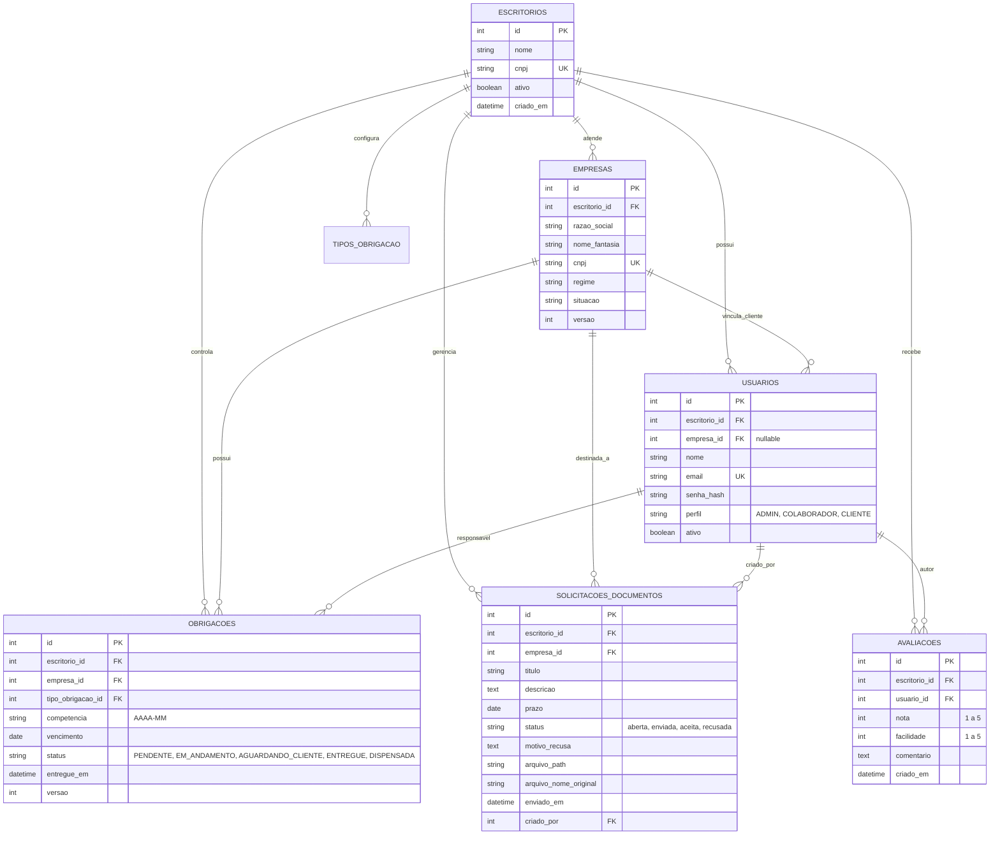

# Relatório do Projeto -Tributo!

**Disciplina:** Programação Web II  
**Instituição:** Colégio Técnico de Teresina – UFPI  
**Data de Entrega:** 18/11/2026  
**Natureza do Projeto:** Acadêmico com potencial comercial (SaaS)

---

## 1. Problema

Escritórios contábeis de micro, pequeno e médio porte enfrentam desafios diários críticos na gestão fiscal e no relacionamento com seus clientes:

1. **Perda de prazos e multas desnecessárias:** O controle de declarações (DAS, DCTFWeb, FGTS, DEFIS, ECD) é frequentemente feito por planilhas manuais ou anotações descentralizadas, gerando esquecimentos e multas pelo fisco.
2. **Documentos e comprovantes perdidos em aplicativos de mensagens:** Extratos bancários, comprovantes de pagamento e notas fiscais circulam em conversas do WhatsApp ou por e-mails dispersos, gerando atrito constante, retrabalho e falta de rastreabilidade.
3. **Ausência de visão única de regularidade:** Nem o contador nem o empresário possuem um diagnóstico visual rápido de como está a saúde fiscal da empresa no mês, descobrindo pendências somente quando uma certidão negativa (CND) é bloqueada.

---

## 2. Solução

O **-Tributo!** é uma plataforma web desenvolvida sob medida para centralizar a operação do escritório contábil e integrar os clientes empresariais de forma direta e sem jargões.

### Principais Pilares da Solução
- **Painel Inicial de Gestão:** Indicadores em tempo real de guias que vencem hoje, nos próximos 7 dias e já atrasadas, além da carga de trabalho por colaborador da equipe contábil.
- **Índice de Regularidade Fiscal (0 a 100):** Algoritmo inteligente que analisa a pontualidade histórica e penaliza atrasos, exibindo semáforo visual (Verde, Amarelo, Vermelho) e recomendando ações preventivas ou imediatas.
- **Destaque para Atrasos Críticos (> 30 dias):** Identificação visual prioritária para pendências que ameaçam o bloqueio de certidões perante a Receita Federal e prefeituras.
- **Inovação — Pendências e Portal do Cliente:** Módulo interativo no qual o contador cria solicitações formais de documentos com prazo estipulado; o empresário acessa pelo celular ou computador, anexa o arquivo (PDF, XML, JPG, PNG) e o contador confere, aceita ou recusa com justificativa clara.
- **Módulo de Avaliação de Satisfação:** Coleta contínua de feedback de usabilidade e notas dos usuários reais (1 a 5 estrelas).

---

## 3. Diagrama Entidade-Relacionamento (ER)

---

## 4. Telas Principais da Aplicação

1. **Login e Autenticação (`/login`):** Acesso seguro com proteção contra força bruta, feedback claro por campo e redirecionamento inteligente baseado no perfil (Contador → `/painel`; Empresário → `/portal`).
2. **Painel do Escritório (`/painel`):** Visão executiva com cartões de vencimentos próximos, resumo de documentos pendentes, semáforo da carteira, lista de piores índices com recomendação de ação e carga da equipe.
3. **Gestão de Empresas (`/empresas`):** Listagem com busca, filtros por regime tributário e situação, paginação, cadastro e edição com controle de versão otimista e validação rigorosa de CNPJ.
4. **Gestão de Obrigações Fiscais (`/obrigacoes`):** Quadro completo de declarações e guias, badges de situação (Vence Hoje, Em 7 dias, Atrasada, Atraso Crítico > 30 dias), histórico cronológico e baixa com registro de protocolo.
5. **Solicitações de Documentos — Contador (`/solicitacoes`):** Criação de pedidos com prazo, listagem com filtros por status (Pendente de Envio, Em Conferência, Aceito, Recusado), download seguro de arquivos e conferência com botão de Aceite ou Recusa fundamentada.
6. **Portal do Empresário (`/portal`):** Interface mobile-first e amigável para o cliente da contabilidade. Apresenta o número de pendências em destaque, formulário de upload de documentos (PDF, XML, imagens) com retorno de conferência e tabela das próximas guias a vencer.
7. **Tela de Avaliação e Metadados (`/avaliacao` e `/avaliacoes`):** Coleta da nota geral (estrelas), índice de facilidade e sugestões abertas; painel analítico com médias e listagem das avaliações recebidas.

---

## 5. Medidas de Segurança Implementadas

A aplicação foi desenvolvida seguindo rigorosamente as melhores práticas da OWASP e da arquitetura segura sem frameworks:

- **Isolamento Multi-tenant Estrito:** Todas as consultas no banco de dados utilizam `escritorio_id` obrigatório. O acesso a registros de outro escritório responde com HTTP 404 (Não Encontrado), impedindo qualquer vazamento de dados ou enumeração de IDs (IDOR).
- **Proteção contra SQL Injection:** Uso 100% exclusivo de PDO com prepared statements (`ATTR_EMULATE_PREPARES=false`). Nenhuma entrada de usuário é concatenada em cláusulas SQL.
- **Proteção contra Cross-Site Scripting (XSS):** Toda saída de dados em views passa pela função auxiliar `e()`, que executa `htmlspecialchars` com `ENT_QUOTES | ENT_SUBSTITUTE` em codificação UTF-8.
- **Proteção contra CSRF:** Tokens criptográficos únicos por sessão validados em todas as requisições de mutação (POST), inclusive em exclusões e alterações de status.
- **Armazenamento Seguro de Arquivos:**
  - Whitelist restrita de extensões permitidas (`pdf`, `jpg`, `jpeg`, `png`, `xml`).
  - Validação profunda do MIME Type real com a extensão `finfo` no conteúdo do arquivo (não confia na extensão informada pelo navegador).
  - Limite rígido de 5 MB por arquivo.
  - Gravação dos arquivos em pasta `storage/uploads/` **fora da raiz pública do servidor (`public/`)**, com nomes aleatórios criptograficamente seguros (evitando sobreposição e directory traversal).
  - Download realizado apenas por rota autenticada que verifica posse e escritório antes de liberar o stream binário.
- **Autenticação e Senhas:** Senhas criptografadas com bcrypt (`password_hash`), mitigação de ataques de temporização (*timing attacks*) com hashes fictícios, bloqueio temporário após tentativas consecutivas inválidas e `session_regenerate_id` após o login.
- **Cabeçalhos de Segurança:** Configurados nos middlewares do Kernel (`X-Content-Type-Options: nosniff`, `X-Frame-Options: DENY`, `Referrer-Policy: same-origin`, `Content-Security-Policy`).

---

## 6. Teste com Usuário Real

Para avaliar a usabilidade e a aderência prática do produto ao cotidiano contábil, realizamos sessões de teste prático com usuários externos.

### Formulário de Registro do Teste com Usuário

| Campo | Dados do Teste |
|---|---|
| **Nome/Identificação do Testador:** | __________________________________________________ |
| **Perfil profissional:** | ( ) Contador(a) &nbsp;&nbsp; ( ) Auxiliar/Assistente &nbsp;&nbsp; ( ) Empresário(a) / Cliente |
| **Tempo de experiência / Ramo:** | __________________________________________________ |
| **Data e duração da sessão:** | Data: ____/____/2026 &nbsp;&nbsp; Duração: _______ minutos |
| **Dispositivo utilizado:** | ( ) Desktop / Computador &nbsp;&nbsp; ( ) Celular / Smartphone |

### Roteiro de Tarefas Executadas no Teste
1. **Tarefa 1 — Autenticação e Visão Geral:** Fazer login com os dados de demonstração e localizar as guias que vencem nos próximos dias.
   - *Resultado:* ( ) Concluído com facilidade &nbsp;&nbsp; ( ) Concluído com dificuldade &nbsp;&nbsp; ( ) Não concluído
2. **Tarefa 2 — Gestão e Baixa de Obrigação:** Acessar uma obrigação em atraso, registrar observação e marcar como entregue.
   - *Resultado:* ( ) Concluído com facilidade &nbsp;&nbsp; ( ) Concluído com dificuldade &nbsp;&nbsp; ( ) Não concluído
3. **Tarefa 3 — Solicitação de Documento:** Criar uma solicitação de extrato bancário para um cliente com prazo determinado.
   - *Resultado:* ( ) Concluído com facilidade &nbsp;&nbsp; ( ) Concluído com dificuldade &nbsp;&nbsp; ( ) Não concluído
4. **Tarefa 4 — Envio pelo Portal do Cliente:** Acessar o portal como empresário no celular e fazer o upload do documento solicitado.
   - *Resultado:* ( ) Concluído com facilidade &nbsp;&nbsp; ( ) Concluído com dificuldade &nbsp;&nbsp; ( ) Não concluído
5. **Tarefa 5 — Conferência e Avaliação:** O contador conferir e aceitar o arquivo enviado; registrar uma avaliação de satisfação na plataforma.
   - *Resultado:* ( ) Concluído com facilidade &nbsp;&nbsp; ( ) Concluído com dificuldade &nbsp;&nbsp; ( ) Não concluído

### Notas Atribuídas pelo Usuário (Escala de 1 a 5)
- **Facilidade geral de uso e navegação:** [ &nbsp;&nbsp; ] / 5
- **Clareza das informações e cores de alerta:** [ &nbsp;&nbsp; ] / 5
- **Utilidade do Portal do Cliente para substituir o WhatsApp:** [ &nbsp;&nbsp; ] / 5
- **Relevância dos indicadores e semáforo do painel:** [ &nbsp;&nbsp; ] / 5

### Problemas e Dificuldades Observadas
> *Espaço para anotação das reações, dúvidas ou hesitações do usuário durante a navegação:*  
> ____________________________________________________________________________________  
> ____________________________________________________________________________________  
> ____________________________________________________________________________________  

### Melhorias Implementadas a partir do Feedback

1. **Melhoria 1 — Alerta Visual de Atraso Crítico (> 30 dias):**
   - *Antes:* Todas as obrigações atrasadas exibiam o mesmo badge de atraso, dificultando diferenciar uma guia vencida há 2 dias de uma vencida há mais de 1 mês.
   - *Depois:* Implementação de badge vermelho específico com destaque para atrasos superiores a 30 dias, auxiliando na prevenção imediata de suspensão de CND.

2. **Melhoria 2 — Recomendação Prática de Ação no Painel:**
   - *Antes:* O painel exibia os clientes com menor pontuação no índice de regularidade apenas com notas numéricas frias.
   - *Depois:* Adição de coluna de "Diagnóstico e Ação Recomendada" com orientação objetiva (ex.: *"Regularizar 1 obrigação com atraso crítico"*) e link que já abre as pendências daquela empresa com um clique.

---

## 7. O que Aprendemos

O desenvolvimento do **-Tributo!** sob restrições técnicas rigorosas (PHP puro sem frameworks comerciais, testes automatizados e arquitetura MVC artesanal) proporcionou aprendizados valiosos:

1. **Arquitetura MVC pura desenvolve fundamentos sólidos:** Construir o roteador, container de injeção, tratamento de requisições, abstrações de banco e motor de visualização a partir do zero ensina como os grandes frameworks (Laravel, Symfony) funcionam por baixo dos panos.
2. **Segurança deve ser pensada na fundação, não adicionada depois:** Garantir isolamento multi-tenant por contrato de código (`escritorio_id`), proteção CSRF universal e upload restrito fora da pasta pública desde a primeira linha de código evita vulnerabilidades graves.
3. **Software útil nasce do diálogo com o usuário final:** O teste prático com contadores e empresários demonstrou que simplicidade de linguagem e rapidez de ação (ex.: portal direto no celular sem jargões contábeis) valem mais do que telas carregadas de gráficos complexos.
