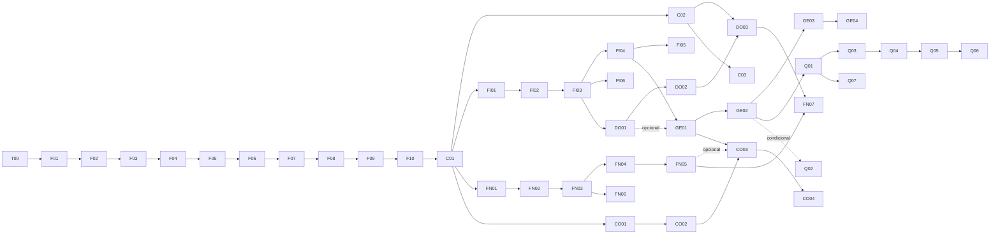

# Roadmap de implementação

> Cada tarefa abaixo é um **cartão autocontido**: outra IA (ou pessoa) consegue executá-la lendo
> apenas [AGENTS.md](../AGENTS.md), o cartão e as seções indicadas em "Ler".
> **Situação do plano:** revisão 2 aprovada; implementação em andamento. T00 e as tarefas F01–F03 estão concluídas; F04 será marcada em andamento após a criação de sua branch.

## Sumário

1. [Como usar este roadmap](#1-como-usar-este-roadmap)
2. [Divisão de trabalho entre as ferramentas de IA](#2-divisão-de-trabalho-entre-as-ferramentas-de-ia)
3. [Cronograma de 7 dias](#3-cronograma-de-7-dias)
4. [Núcleo obrigatório e ordem de inclusão](#4-núcleo-obrigatório-e-ordem-de-inclusão)
5. [Posse de arquivos](#5-posse-de-arquivos)
6. [Quadro de situação](#6-quadro-de-situação)
7. [Cartões das tarefas](#7-cartões-das-tarefas)

---

## 1. Como usar este roadmap

**Legenda de situação:** ⬜ planejada · 🟨 em andamento · 🟦 em revisão · ✅ concluída · ⏭️ adiada para a continuação pós-entrega (R1.1)

**Prioridade:** **M** obrigatória (núcleo) · **S** planejada, entra conforme a ordem de inclusão (§4.2) · **C** só com folga · **Cond.** condicional a fatores externos (ver [PRODUCT.md §5](PRODUCT.md#5-avaliação-de-viabilidade-por-funcionalidade)).

**Criticidade (define quem implementa e quem revisa):**

| Marca | Significado | Implementação | Revisão |
|:-----:|-------------|---------------|---------|
| 🔒 | Segurança, isolamento ou dinheiro | Claude Sonnet (ou Opus) | **Obrigatória** por uma segunda IA com o checklist de segurança do AGENTS.md; reler pessoalmente |
| ◆ | Regra de negócio | Claude Sonnet ou equivalente | Revisão cruzada (Gemini ou ChatGPT) |
| ○ | Simples, padrão repetido | Modelo econômico ou Copilot | Revisão rápida própria + `composer check` |

**Ciclo de uma tarefa:**

1. `git switch main && git pull` → `git switch -c <branch do cartão>`.
2. Abrir a IA implementadora com o **prompt de execução** (AGENTS.md §8) + o cartão.
3. A IA entrega **testes primeiro**, depois o código, só nos arquivos do cartão.
4. Executar `composer check` localmente. Tudo verde? Senão, corrigir na mesma branch.
5. Revisão conforme a criticidade (prompt de revisão em AGENTS.md §9).
6. **Ler e entender o código** (é você quem apresenta). Pedir ao Copilot "explique este arquivo" quando necessário.
7. Commit(s) com a mensagem do cartão → push → Pull Request → merge em `main`.
8. Atualizar a situação no §6 deste arquivo, a seção de situação em [API.md](API.md#10-situação-de-implementação) e o README, quando houver.

**Definição de pronto (vale para todas as tarefas):**

- [ ] Critérios de aceite do cartão atendidos.
- [ ] Testes do cartão escritos e passando; `composer check` verde.
- [ ] Nenhum arquivo alterado fora da lista do cartão (ou mudança aprovada e registrada).
- [ ] Sem `var_dump`, `print_r`, `dd`, código comentado ou TODO sem tarefa associada.
- [ ] Toda saída em view com `e()`; todo POST com `csrf_campo()`; todo SQL parametrizado e filtrado por `escritorio_id`.
- [ ] Documentação do módulo atualizada (API.md e/ou DATABASE.md, se o cartão pedir).

## 2. Divisão de trabalho entre as ferramentas de IA

| Ferramenta | Papel | Quando usar |
|------------|-------|-------------|
| **Claude Opus** | Arquitetura, contratos do núcleo, decisões, revisão de tarefas 🔒, revisão de fase | Planejamento (feito), revisão de F03, F06, F07, F08, F09, DO02, FN04, Q01; quando algo exigir mudar um contrato |
| **Claude Sonnet** (ou modelo intermediário) | Implementar cartões ◆ e 🔒 seguindo os contratos | Maioria das tarefas |
| **GitHub Copilot** (VS Code) | Completar código, gerar variações repetitivas (views, formulários), explicar trechos, pequenos ajustes | Durante a implementação e a leitura; tarefas ○ |
| **Gemini / ChatGPT** | Revisão cruzada com checklist, investigação de bugs, explicações alternativas | Revisão de ◆, segunda opinião em 🔒, diagnóstico de erros |

**Independência de ferramenta:** nenhuma regra fica "na memória" de uma IA. Tudo está em `AGENTS.md` (lido pelo Claude via `CLAUDE.md` e pelo Copilot via `.github/copilot-instructions.md`) e nestes cartões. Qualquer IA pode substituir outra.

## 3. Cronograma de 7 dias

> **Revisão 2:** a primeira versão previa cerca de 44 tarefas em 7 dias, com várias por dia em duas faixas. Isso
> desconsiderava o tempo de revisar, testar e **entender** cada entrega. Este cronograma parte da capacidade de
> revisão, não da velocidade de geração das IAs (ver DECISIONS ADR-022).

### 3.1 Estimativa de esforço por tarefa (hipótese a medir nos dias 1 e 2)

| Criticidade | Gerar e ajustar | Revisão por IA | Ler, testar e entender | Total aproximado |
|:-----------:|:---------------:|:--------------:|:----------------------:|:----------------:|
| 🔒 | 45 min | 45 min | 60 min | **≈ 2h30** |
| ◆ | 30 min | 30 min | 45 min | **≈ 1h45** |
| ○ | 20 min | 10 min | 20 min | **≈ 50 min** |

Some ainda **≈ 45 min por dia** de rotina: reconstruir o banco, navegar pelo sistema, atualizar o §6 e fazer o merge. Com 7 a 8 horas produtivas por dia, a capacidade realista é de **2 a 4 tarefas por dia**.

**Consequência:** o **núcleo M** (22 tarefas além da T00: ≈ 44 h de tarefas, somando teste com usuário, melhorias e documentação, + ≈ 5 h de rotina) ocupa sozinho cerca de **6 dias de 8 horas**, deixando por volta de 1 dia de folga para imprevistos. Os módulos S **continuam no plano do produto**, mas só entram na entrega acadêmica se a velocidade medida permitir (§4). Caso contrário, viram a continuação pós-entrega (R1.1, ver PRODUCT §6).

### 3.2 Plano base (somente o núcleo M)

| Dia | Tarefas | Ponto de verificação ao final do dia (concreto e testável) |
|-----|---------|-------------------------------------------------------------|
| **D1** | Preparação · F01 · F02 · F03 | `php bin/db.php rebuild` cria o banco; `composer check` verde; **você explica** `Env`, `Database::transacao` e o Validator |
| **D2** | F04 · F05 · F06 | Uma rota inexistente mostra a página 404 pelo Kernel; o Model base filtra por escritório (teste) |
| **D3** | F07 · F08 · F09 | Login e logout no navegador com os usuários do seed; cliente recebe 403 em rota do escritório |
| **D4** | F10 · C01 | CRUD de empresas completo no navegador, com busca, filtros e paginação · **Ponto de decisão B** |
| **D5** | FI01 · FI02 · FI03 · FI04 | Obrigações cadastradas, filtradas e com status alterado; histórico visível |
| **D6** | GE01 · GE02 · Q01 · Q03 (teste com usuário, à tarde) | Painel e Índice funcionando; suíte de segurança verde · **Congelamento de funcionalidades** |
| **D7** | Q04 · Q05 · Q06 · Q02 (só se as condições forem atendidas) | Melhorias implementadas; README final; `rebuild` local ensaiado como plano principal da apresentação |

**Preparação (D1, antes da F01), sem código:**
- instalar o Composer e habilitar `extension=zip`; mover o projeto para `C:\xampp\htdocs\tributo`;
- **agendar o participante do teste com usuário** (Q03) para o D6 ou o D7 (é a dependência externa mais arriscada);
- verificar se há uma hospedagem disponível (informação para a decisão do Q02, sem configurar nada ainda).

### 3.3 Regras de ritmo

1. **Uma tarefa só termina quando você consegue explicar cada arquivo em até 2 minutos.** Sem isso, ela continua 🟦 em revisão.
2. **No máximo uma tarefa 🔒 em revisão por vez.** Faixa paralela, só para tarefas ○ ou para tarefas S já liberadas no §4.
3. **Nunca comece uma tarefa S** enquanto houver uma tarefa M vermelha (`composer check` falhando) ou em revisão.
4. **Tarefa que passar de 2× a estimativa:** pare, peça ao Opus para dividi-la ou reduza o escopo do cartão (registrando a redução). Não "empurre" um núcleo instável.
5. **Fim de cada dia:** `php bin/db.php rebuild` → navegar pelos fluxos prontos → `composer check` → atualizar o §6 → anotar as horas gastas por tarefa (para medir a velocidade real).

**Dependências entre tarefas:**

## 4. Núcleo obrigatório e ordem de inclusão

### 4.1 Núcleo M (sempre entregue)

T00, F01–F10, C01, FI01–FI04, GE01, GE02, Q01, Q03, Q04, Q05, Q06.

Ele atende todos os requisitos acadêmicos:

| Requisito da disciplina | Onde é atendido |
|-------------------------|-----------------|
| 2 entidades relacionadas com CRUD completo | Empresas (C01) e Obrigações (FI03), relacionadas por FK |
| Listagens com busca, filtros e paginação | C01, FI03 (F06 fornece a base) |
| Login com sessão | F07, F08 |
| Painel com indicadores | GE02 |
| Funcionalidade inovadora | Índice de Regularidade (GE01) |
| Validação no servidor com mensagens por campo | F02 + todos os formulários |
| SQL Injection, XSS, CSRF, hash de senhas | F06, F05/F10, F07, F08 + Q01 |
| Script SQL com dados de exemplo | F03, FI01 (`database/tributo.sql` gerado) |
| README com instalação e usuários de teste | T00 → Q06 |
| Teste com usuário real + 2 melhorias | Q03, Q04, Q05 |

**Mudanças em relação à revisão 1:** C02 (usuários) e FI05 (gerador) saíram do núcleo e viraram as primeiras inclusões S. Os usuários de demonstração vêm do seed, e as obrigações podem ser criadas manualmente e pelo seed. Q02 (publicação) passou a ser **condicional** (condições no cartão Q02), e a medição de cobertura virou uma tarefa própria e secundária (Q07).

### 4.2 Ordem de inclusão das tarefas S (substitui a "ordem de corte")

Os módulos S **não são descartados**: entram **nesta ordem**, um bloco por vez, somente quando o ponto de decisão permitir. O que não entrar fica marcado ⏭️ (continuação pós-entrega, R1.1), sem perder o cartão.

| Ordem | Bloco | Tarefas | Por que nesta posição |
|:-----:|-------|---------|-----------------------|
| 1 | Gerador de competência | FI05 | Pequeno, dá muito valor à demonstração da rotina fiscal |
| 2 | Documentos e portal | C02 → DO01 → DO02 → DO03 | Proposta de venda mais forte ("fim do WhatsApp"); exige usuários CLIENTE (C02) |
| 3 | Visão 360º | GE03 | Pequena; integra o que existir |
| 4 | BPO financeiro essencial | FN01 → FN02 → FN03 → FN04 → FN05 | Módulo comercial pago; grande (≈ 10 h) |
| 5 | Consultivo essencial | CO01 → CO02 → CO03 | Depende de dados fiscais e, de preferência, financeiros |
| 6 | Relatório mensal | GE04 | Fica melhor com os blocos 4 e 5 prontos |
| 7 | Tarefas C | FI06, C03, FN06, FN07, CO04, Q07 | Só com folga real |

### 4.3 Pontos de decisão

| Ponto | Quando | Pergunta | Se **sim** | Se **não** |
|-------|--------|----------|------------|------------|
| **A** | Fim do D2 | F01–F06 concluídas **e compreendidas**? | Seguir o plano base | Todas as tarefas S passam para depois da entrega; avaliar com o Opus uma simplificação de F09/F10 |
| **B** | Fim do D4 | C01 concluída e velocidade medida ≥ 3 tarefas/dia? | Liberar o bloco 1 (FI05) em faixa paralela no D5 | Seguir só o núcleo; nenhuma S até o congelamento |
| **C** | Meio do D6 | GE02 pronta com ≥ 0,5 dia de folga projetada até o fim do D7? | Liberar o próximo bloco da ordem de inclusão, **apenas se couber antes do congelamento** | Congelar; dedicar o restante ao teste, às melhorias e à documentação |
| **Congelamento** | Fim do D6 | — | Depois daqui: só Q03–Q06, correções de bugs e Q02 condicional | — |

### 4.4 Simplificações permitidas dentro do núcleo (último recurso)

Se até o núcleo correr risco, reduza o escopo **sem retirar requisitos acadêmicos**, registrando a redução no cartão:

- **GE02:** apenas os indicadores de obrigações e a distribuição por semáforo (sem carga por responsável nem cartões de módulos).
- **F10:** CSS mínimo; layout de impressão e partials não usados ficam para depois.
- **FI04:** manter a matriz de transições completa (é regra de negócio testada), mas o histórico pode ser uma lista simples.
- **Testes E2E:** priorizar os fluxos do núcleo e os testes de segurança da Q01; E2E de telas secundárias podem virar roteiro manual documentado.

## 5. Posse de arquivos

Regra: **uma tarefa só altera os arquivos do próprio cartão.** Arquivos de outra faixa estão bloqueados. Para mudar um arquivo do núcleo depois da fundação, crie uma tarefa de manutenção (`Mxx`), aprovada e executada sem nenhuma outra tarefa em paralelo.

| Faixa / dono | Arquivos exclusivos |
|--------------|---------------------|
| Fundação (F01–F10) | `app/Core/**`, `app/Middleware/**`, `app/Exceptions/**`, `app/Support/{Relogio*,Cnpj}.php`, `app/Views/{layouts,partials,erros}/**`, `public/**`, `config/app.php`, `config/modules/nucleo.php`, `bin/**`, `tests/bootstrap.php`, `tests/Support/{BancoDeTeste,ClienteHttp}.php`, `tests/Integration/IntegrationTestCase.php`, `tests/E2E/E2ETestCase.php`, `composer.json`, `phpunit.xml`, `phpstan.neon` |
| Cadastro (C01–C03) | `*/Cadastro/**`, `app/Views/cadastro/**`, `config/modules/cadastro.php`, `tests/Support/FabricaCadastro.php` |
| Fiscal (FI) | `*/Fiscal/**`, `app/Views/fiscal/**`, `config/modules/fiscal.php`, `database/{schema,seeds}/02_fiscal.sql`, `tests/Support/FabricaFiscal.php` |
| Documentos (DO) | `*/Documentos/**`, `*/Portal/**`, `app/Views/{documentos,portal}/**`, `config/modules/{documentos,portal}.php`, `database/{schema,seeds}/03_documentos.sql`, `tests/Support/FabricaDocumentos.php` |
| Financeiro (FN) | `*/Financeiro/**`, `app/Support/Dinheiro.php`, `app/Views/financeiro/**`, `config/modules/financeiro.php`, `database/{schema,seeds}/04_financeiro.sql`, `tests/Support/FabricaFinanceiro.php` |
| Gestão (GE) | `*/Gestao/**`, `app/Views/gestao/**`, `config/modules/gestao.php`, `config/regras/regularidade.php` |
| Consultivo (CO) | `*/Consultivo/**`, `app/Views/consultivo/**`, `config/modules/consultivo.php`, `config/regras/radar.php`, `database/{schema,seeds}/05_consultivo.sql`, `tests/Support/FabricaConsultivo.php` |
| Qualidade (Q) | `tests/Integration/Seguranca/**`, `tests/E2E/**` (novos arquivos), `docs/TESTE-USUARIO.md`, `docs/PUBLICACAO.md`, `bin/cobertura.php` |

`*/Modulo/**` = `app/Controllers/Modulo/**`, `app/Models/Modulo/**`, `app/Services/Modulo/**`, `tests/Unit/Modulo/**`, `tests/Integration/Modulo/**`.

**Arquivos compartilhados (com regra própria):**

| Arquivo | Regra |
|---------|-------|
| `database/tributo.sql` | **Gerado.** Nunca editar à mão. Em conflito de merge: aceitar qualquer versão e rodar `php bin/db.php build` |
| `docs/API.md`, `docs/DATABASE.md` | Cada tarefa altera **apenas a seção do próprio módulo** e a linha correspondente na tabela de situação |
| `docs/ROADMAP.md` §6, `README.md` | Atualizados por você no momento do merge, não pela IA |
| `docs/DECISIONS.md` | Só com decisão aprovada (novo ADR no final do arquivo) |

## 6. Quadro de situação

| ID | Tarefa | Prior. | Crit. | Faixa | Depende de | Situação |
|----|--------|:------:|:-----:|-------|------------|:--------:|
| T00 | Estrutura inicial e documentação | M | ○ | Fundação | — | ✅ |
| F01 | Configuração por ambiente, PDO e relógio | M | ◆ | Fundação | T00 | ✅ |
| F02 | CNPJ e Validator com erros por campo | M | ◆ | Fundação | F01 | ✅ |
| F03 | Banco do núcleo, seeds e ferramenta `bin/db.php` | M | 🔒 | Fundação | F02 | ✅ |
| F04 | Request, Response, Router e Container | M | ◆ | Fundação | F01 | 🟨 |
| F05 | View, helpers, Kernel, carregador de módulos, páginas de erro | M | ◆ | Fundação | F04 | ⬜ |
| F06 | Model base, paginação, filtros seguros e auditoria | M | 🔒 | Fundação | F03, F05 | ⬜ |
| F07 | Sessão segura, CSRF e headers de segurança | M | 🔒 | Fundação | F05 | ⬜ |
| F08 | Autenticação, bloqueio por tentativas e UsuarioLogado | M | 🔒 | Fundação | F06, F07 | ⬜ |
| F09 | Middlewares de perfil e de módulo | M | 🔒 | Fundação | F08 | ⬜ |
| F10 | Layouts, menu dinâmico, flash, partials, CSS e JS | M | ○ | Fundação | F09 | ⬜ |
| C01 | CRUD de empresas | M | ◆ | Cadastro | F10 | ⬜ |
| C02 | Usuários e "meu perfil" | S | 🔒 | Cadastro | C01 | ⬜ |
| C03 | Página "Plano e módulos" | C | ○ | Cadastro | C02 | ⬜ |
| FI01 | Schema, seeds e fábrica do fiscal | M | ◆ | Fiscal | C01 | ⬜ |
| FI02 | Tipos de obrigação e vínculo com empresas | M | ○ | Fiscal | FI01 | ⬜ |
| FI03 | CRUD de obrigações com filtros | M | ◆ | Fiscal | FI02 | ⬜ |
| FI04 | Fluxo de status e histórico | M | ◆ | Fiscal | FI03 | ⬜ |
| FI05 | Gerador de obrigações por competência | S | ◆ | Fiscal | FI04 | ⬜ |
| FI06 | Calendário de vencimentos | C | ○ | Fiscal | FI03 | ⬜ |
| DO01 | Schema e solicitações de documento | S | ◆ | Documentos | FI03 | ⬜ |
| DO02 | Upload e download seguros | S | 🔒 | Documentos | DO01 | ⬜ |
| DO03 | Portal do cliente | S | 🔒 | Documentos | DO02, C02 | ⬜ |
| GE01 | Índice de Regularidade | M | ◆ | Gestão | FI04, DO01* | ⬜ |
| GE02 | Painel do escritório | M | ◆ | Gestão | GE01 | ⬜ |
| GE03 | Visão geral 360º da empresa | S | ○ | Gestão | GE02 | ⬜ |
| GE04 | Relatório mensal imprimível | S | ◆ | Gestão | GE03 (+FN05, CO02 se existirem) | ⬜ |
| FN01 | Schema, seeds, Dinheiro e fábrica do financeiro | S | 🔒 | Financeiro | C01 | ⬜ |
| FN02 | Categorias gerenciais e contas | S | ○ | Financeiro | FN01 | ⬜ |
| FN03 | Lançamentos (a pagar e a receber) | S | ◆ | Financeiro | FN02 | ⬜ |
| FN04 | Baixa, estorno e cancelamento | S | 🔒 | Financeiro | FN03 | ⬜ |
| FN05 | Indicadores, fluxo de caixa e painel financeiro | S | ◆ | Financeiro | FN04 | ⬜ |
| FN06 | Visão da carteira BPO | C | ○ | Financeiro | FN03 | ⬜ |
| FN07 | Financeiro no portal do cliente | C | 🔒 | Financeiro | FN05, DO03 | ⬜ |
| CO01 | Schema e acompanhamentos | S | ○ | Consultivo | C01 | ⬜ |
| CO02 | Plano de ação | S | ◆ | Consultivo | CO01 | ⬜ |
| CO03 | Radar de alertas e oportunidades | S | ◆ | Consultivo | CO02, GE01, FN05* | ⬜ |
| CO04 | Radar da carteira | C | ○ | Consultivo | CO03 | ⬜ |
| Q01 | Suíte de segurança consolidada | M | 🔒 | Qualidade | GE02 (+DO03 se existir) | ⬜ |
| Q02 | Publicação em hospedagem | Cond. | ◆ | Qualidade | GE02 + hospedagem disponível | ⬜ |
| Q03 | Roteiro e execução do teste com usuário real | M | ○ | Qualidade | Q01 (agendamento no D1) | ⬜ |
| Q04 | Melhoria 1 vinda do teste | M | — | Qualidade | Q03 | ⬜ |
| Q05 | Melhoria 2 vinda do teste | M | — | Qualidade | Q03 | ⬜ |
| Q06 | Documentação final e ensaio da apresentação local | M | ○ | Qualidade | Q05 | ⬜ |
| Q07 | Medição de cobertura (meta de 80%, objetivo secundário) | C | ○ | Qualidade | Q01 | ⬜ |

\* Dependência opcional: a regra correspondente é omitida se o módulo não existir (ver o cartão).

---

## 7. Cartões das tarefas

Formato: **Ler** (documentos de contexto) · **Arquivos** (os únicos que podem ser criados ou alterados) · **Escopo** · **Aceite** · **Testes** · **Commit** · **Branch**.
Os caminhos de teste seguem `tests/<Nível>/<Modulo>/<Classe>Test.php`.

### Fundação

#### T00 — Estrutura inicial e documentação ✅
Concluída. Estrutura de pastas, `composer.json` (PSR-4, PHPUnit 11, PHPStan 2), `.gitignore`, `.env.example`, `.env.production.example`, `.htaccess` (raiz e `public/`), `public/index.php` provisório, `bin/lint.php`, `phpunit.xml`, `phpstan.neon`, `tests/Unit/AmbienteTest.php`, documentação em `docs/`, `AGENTS.md`, `CLAUDE.md`, `.github/copilot-instructions.md`.
**Não inclui nada de banco de dados:** nenhum arquivo `.sql`, nenhum `bin/db.php` e nenhum teste de banco. `database/schema/` e `database/seeds/` contêm apenas `.gitkeep`. O banco começa a ser implementado na F03. A verificação manual do DDL feita durante a T00 está descrita em [DATABASE.md §8](DATABASE.md#8-situação-da-implementação-e-da-validação).
Commit: `chore: configurar estrutura inicial do projeto`.

#### F01 — Configuração por ambiente, PDO e relógio · M · ◆
- **Ler:** ARCHITECTURE §5 (Env, Config, Database, Relogio), §9.
- **Arquivos:** `app/Core/Env.php`, `app/Core/Config.php`, `app/Core/Database.php`, `app/Support/Relogio.php`, `app/Support/RelogioSistema.php`, `app/Support/RelogioFixo.php`, `config/app.php`, `tests/Unit/Core/EnvTest.php`, `tests/Unit/Core/ConfigTest.php`, `tests/Unit/Support/RelogioTest.php`, `tests/Integration/Core/DatabaseTest.php`.
- **Escopo:**
  - `Env::carregar()`: linhas `CHAVE=valor`; ignora linhas vazias e `#`; remove aspas duplas ou simples externas; **não sobrescreve** variáveis já definidas no ambiente (o PHPUnit força `APP_ENV=testing`); arquivo inexistente gera uma exceção com a mensagem "Crie o arquivo .env a partir de .env.example".
  - `config/app.php` devolve um array com as chaves: `app.{nome,env,debug,url,base_path,timezone}`, `db.{host,porta,banco,usuario,senha,charset,banco_teste}`, `sessao.{nome,inatividade_min,cookie_seguro}`, `login.{max_tentativas,bloqueio_min}`, `upload.{max_bytes,caminho}`, `log.{nivel,caminho}`. Converte `true`/`false` e números. Se `app.env === 'testing'`, `db.banco` recebe `db.banco_teste`.
  - `Config::obter('db.host')` em notação de ponto; `Config::regras(string $nome): array` carrega `config/regras/<nome>.php`; `Config::definir()` só para testes.
  - `Database::conexao()`: PDO com `ERRMODE_EXCEPTION`, `DEFAULT_FETCH_MODE=FETCH_ASSOC`, `EMULATE_PREPARES=false`; executa `SET NAMES utf8mb4` e `SET time_zone = '-03:00'`. `Database::transacao(callable)`: se **já houver transação aberta, apenas executa** o callable (permite testes dentro de transação); senão, begin/commit/rollback com o relançamento da exceção.
  - `RelogioSistema` usa `APP_TIMEZONE`; `RelogioFixo` recebe a data no construtor.
- **Aceite:** variáveis lidas corretamente; sem `.env` aparece a mensagem orientadora; conexão abre com o XAMPP ligado; `transacao` faz rollback em caso de exceção.
- **Testes:** EnvTest (comentário, aspas, linha vazia, não sobrescrever, arquivo ausente); ConfigTest (notação de ponto, padrão, troca para o banco de teste); RelogioTest; DatabaseTest (conecta; rollback; transação aninhada) — marcado como *skipped* com "Inicie o MySQL no XAMPP" se o servidor não responder.
- **Commit:** `feat: adicionar configuração por ambiente e conexão PDO`
- **Branch:** `feat/f01-configuracao-banco`

#### F02 — CNPJ e Validator com erros por campo · M · ◆
- **Ler:** ARCHITECTURE §5 (Validator), §6.
- **Arquivos:** `app/Support/Cnpj.php`, `app/Core/Validator.php`, `tests/Unit/Support/CnpjTest.php`, `tests/Unit/Core/ValidatorTest.php`.
- **Escopo:**
  - `Cnpj::normalizar(string): string` (remove `.`, `/`, `-` e espaços; maiúsculas); `Cnpj::validar(string): bool` (14 caracteres; 12 primeiros `[0-9A-Z]`, 2 últimos dígitos; rejeita todos iguais; dígitos verificadores calculados pelo **módulo 11 com pesos 2–9**, convertendo cada caractere pelo valor `ord(c) − 48`, regra do CNPJ alfanumérico). **Antes de implementar, confira o algoritmo na especificação oficial da Receita Federal e cite a fonte em um comentário.** `Cnpj::formatar()` aplica a máscara `XX.XXX.XXX/XXXX-XX`; `Cnpj::gerarFicticio(int $semente)` gera CNPJs numéricos válidos para seeds e testes.
  - `Validator::validar(array $dados, array $regras): array<string, list<string>>`. Cada campo em `$regras` contém `rotulo` e `regras`; estas são separadas por `|`, com parâmetros após `:`. A regra `em` recebe opções separadas por vírgula. Regras: `obrigatorio`, `max:N`, `min:N` (comprimento textual), `email`, `cnpj`, `data` (AAAA-MM-DD válida), `competencia` (AAAA-MM), `inteiro`, `decimal` (aceita `1.234,56` e `1234.56`), `em:A,B,C`, `minimo:N` e `maximo:N` (comparações numéricas), `depois_ou_igual:outro_campo` (datas), `confirmado` (campo `<nome>_confirmacao`). Campo opcional vazio, inclusive contendo apenas espaços, ignora as demais regras. Mensagens em português usam o `rotulo` do campo. Regras desconhecidas ou malformadas geram `InvalidArgumentException`.
- **Aceite:** retorna um array vazio quando válido; mensagens por campo; CNPJ numérico e alfanumérico validados.
- **Testes:** CnpjTest (válidos e inválidos numéricos, alfanuméricos, máscara, repetidos, tamanho errado, `gerarFicticio` sempre válido); ValidatorTest (≥ 30 casos, um por regra + combinações).
- **Commit:** `feat: adicionar validação de CNPJ e validador por campo`
- **Branch:** `feat/f02-validator`

#### F03 — Banco do núcleo, seeds e ferramenta `bin/db.php` · M · 🔒
- **Ler:** DATABASE §1, §3, §4.1, §7; ARCHITECTURE §9; ARCHITECTURE §12.2 (isolamento dos testes).
- **Arquivos:** `database/schema/01_nucleo.sql`, `database/seeds/01_nucleo.sql`, `database/tributo.sql` (gerado), `bin/db.php`, `tests/bootstrap.php`, `tests/Support/BancoDeTeste.php`, `tests/Integration/IntegrationTestCase.php`, `tests/Integration/Nucleo/SchemaNucleoTest.php`, `tests/Integration/Nucleo/TributoSqlAtualizadoTest.php`.
- **Escopo:**
  - Copiar o DDL de DATABASE §4.1 **sem alterações**.
  - Seeds do núcleo conforme DATABASE §7 (escritórios, módulos, usuários com hash de `Senha@123`, empresas com CNPJs de `Cnpj::gerarFicticio`).
  - `bin/db.php rebuild [--test] [--sem-seed]`: conecta sem banco, `DROP/CREATE DATABASE` (nome de `db.banco` ou `db.banco_teste`), executa `schema/*.sql` e `seeds/*.sql` em ordem numérica. Divisor de comandos: `;` no fim da linha (por regra, não usamos procedures nem triggers).
  - `bin/db.php build`: gera `database/tributo.sql` (cabeçalho com data e aviso "arquivo gerado", `SET FOREIGN_KEY_CHECKS=0`, `DROP TABLE IF EXISTS` de todas as tabelas encontradas nos `CREATE TABLE`, em ordem inversa, schema, seeds, `SET FOREIGN_KEY_CHECKS=1`). **Sem `CREATE DATABASE`**.
  - `IntegrationTestCase`: no `setUpBeforeClass`, chama `BancoDeTeste::preparar()` (recria `tributo_test` só com o schema, **uma vez por execução**); `setUp` abre uma transação e `tearDown` faz rollback.
- **Aceite:** `php bin/db.php rebuild` cria o banco local com os dados; `php bin/db.php build` gera um arquivo importável no phpMyAdmin; os testes unitários continuam rodando sem banco.
- **Testes:** SchemaNucleoTest (FK composta rejeita cliente com empresa de outro escritório e responsável de outro escritório; CHECK de cliente sem empresa; e-mail duplicado; CNPJ duplicado no mesmo escritório e permitido em outro). Estes testes **automatizam** as verificações manuais do núcleo descritas em DATABASE §8.2. TributoSqlAtualizadoTest (gera em memória e compara com o arquivo versionado).
- **Commit:** `feat: adicionar banco do núcleo e ferramenta de reconstrução`
- **Branch:** `feat/f03-banco-nucleo`

#### F04 — Request, Response, Router e Container · M · ◆
- **Ler:** ARCHITECTURE §2, §5 (Request, Response, Router, Container).
- **Arquivos:** `app/Core/Request.php`, `app/Core/Response.php`, `app/Core/Router.php`, `app/Core/RotaResolvida.php`, `app/Core/Container.php`, `app/Exceptions/NaoEncontradoException.php`, `app/Exceptions/MetodoNaoPermitidoException.php`, `tests/Unit/Core/{RequestTest,ResponseTest,RouterTest,ContainerTest}.php`.
- **Escopo:** `Request::capturar(string $basePath)` remove o `APP_BASE_PATH` do caminho e normaliza a barra final; `Request` também pode ser criada manualmente nos testes. `Router`: parâmetros `{nome}` só numéricos; 404 para caminho desconhecido; 405 para método errado; exceção para rota duplicada. `Container`: autowiring por reflexão de construtores com classes tipadas; `definir()` para instâncias prontas (ex.: `Relogio`). `Response::enviar()` emite os headers e o corpo.
- **Aceite:** rotas resolvidas com parâmetros como `int`; base path removido corretamente (`/tributo/empresas/7` → `/empresas/7`).
- **Testes:** casos de rota estática, com parâmetro, parâmetro não numérico (404), 405, duplicada; Request com e sem base path; Container com dependência encadeada.
- **Commit:** `feat: adicionar request, response, roteador e container`
- **Branch:** `feat/f04-roteamento`

#### F05 — View, helpers, Kernel, carregador de módulos e páginas de erro · M · ◆
- **Ler:** ARCHITECTURE §4 inteiro, §5 (Kernel, View, helpers, exceções).
- **Arquivos:** `app/Core/View.php`, `app/Core/helpers.php`, `app/Core/Kernel.php`, `app/Core/Modulos.php`, `app/Core/CartaoPainel.php`, `app/Core/Controller.php`, `app/Exceptions/{AcessoNegadoException,ConflitoException,ModuloInativoException,CsrfException}.php`, `app/Views/erros/{403,404,405,409,419,500,modulo-inativo}.php`, `app/Views/layouts/erro.php`, `config/modules/nucleo.php` (apenas `GET /` provisório), `public/index.php`, `composer.json` (somente `autoload.files: ["app/Core/helpers.php"]`), `tests/Unit/Core/{ViewTest,HelpersTest,ModulosTest,KernelTest}.php`.
- **Escopo:** `e()` com `ENT_QUOTES|ENT_SUBSTITUTE`; `url()` com `APP_BASE_PATH`; `View::render` com buffer de saída e variáveis extraídas; `Modulos` carrega `config/modules/*.php`, valida as chaves e, se `contratavel` não for nulo, acrescenta `modulo:<CODIGO>` às rotas; `Kernel` aplica o pipeline de middlewares (os nomes registrados ficam num mapa vazio até F07–F09), chama o controller via Container e mapeia as exceções da ARCHITECTURE §5; log de erros em `storage/logs/app-AAAA-MM-DD.log`. `public/index.php` passa a usar o Kernel. Os helpers `csrf_campo`, `antigo`, `erro_campo`, `dinheiro` e `data_br` ficam declarados aqui; `csrf_campo` lê o token via `Csrf` (stub até F07).
- **Aceite:** `http://localhost/tributo/` responde pelo Kernel; uma rota inexistente mostra a página 404; uma exceção mostra 500 sem detalhes com `APP_DEBUG=false`.
- **Testes:** escape de XSS, `url()` com e sem base, módulo inválido gera exceção, contratável acrescenta o middleware, Kernel converte cada exceção no status correto.
- **Commit:** `feat: adicionar kernel, views e carregamento de módulos`
- **Branch:** `feat/f05-kernel-views`

#### F06 — Model base, paginação, filtros seguros e auditoria · M · 🔒
- **Ler:** ARCHITECTURE §5 (Model, Paginacao, AuditoriaService), §6 itens 5–7, §7.
- **Arquivos:** `app/Core/Model.php`, `app/Core/Paginacao.php`, `app/Core/Pagina.php`, `app/Core/QueryFiltros.php`, `app/Models/Nucleo/LogAtividade.php`, `app/Services/Nucleo/AuditoriaService.php`, `tests/Unit/Core/{PaginacaoTest,QueryFiltrosTest}.php`, `tests/Integration/Nucleo/{ModelTest,AuditoriaServiceTest}.php`.
- **Escopo:** `Paginacao::deRequest()` normaliza a página (inválida → 1); `paginar()` executa o count e o select com `LIMIT/OFFSET` como inteiros validados; `QueryFiltros::like(string)` escapa `%`, `_` e `\`; `QueryFiltros::ordenacao(?string $param, array $permitidos, string $padrao)` retorna `"coluna ASC|DESC"` somente da whitelist. `AuditoriaService::registrar()` grava em `logs_atividade` com o IP da requisição.
- **Aceite:** nenhuma interpolação de entrada do usuário em SQL; página acima do total devolve a última.
- **Testes:** paginação (0, negativa, texto, além do total, total zero); like com `50%_off`; ordenação maliciosa (`id;DROP`) devolve o padrão; auditoria grava e lê `detalhes` JSON.
- **Commit:** `feat: adicionar model base, paginação e auditoria`
- **Branch:** `feat/f06-model-base`

#### F07 — Sessão segura, CSRF e headers de segurança · M · 🔒
- **Ler:** ARCHITECTURE §5 (Session, Csrf), §8.
- **Arquivos:** `app/Core/Session.php`, `app/Core/Csrf.php`, `app/Middleware/SessaoMiddleware.php`, `app/Middleware/CsrfMiddleware.php`, `app/Core/HeadersSeguranca.php`, `app/Core/Kernel.php` (somente registrar `sessao` e `csrf` como globais e aplicar os headers), `tests/Unit/Core/{CsrfTest,SessionTest,HeadersSegurancaTest}.php`.
- **Escopo:** opções de cookie (`httponly`, `samesite=Lax`, `secure` conforme o `.env`), `use_strict_mode`, expiração por inatividade (flash "Sua sessão expirou"); flash consumido uma única vez; token CSRF de 32 bytes por sessão, validado com `hash_equals` em todo POST (inclusive `/login`); headers da ARCHITECTURE §8. A `Session` aceita um armazenamento em array para os testes.
- **Aceite:** POST sem token → 419; os headers aparecem em todas as respostas, inclusive nas de erro.
- **Testes:** token válido, inválido, ausente, de outra sessão; expiração por inatividade com `RelogioFixo`; flash lido uma vez; presença de cada header.
- **Commit:** `feat: adicionar sessão segura, CSRF e headers de segurança`
- **Branch:** `feat/f07-sessao-csrf`

#### F08 — Autenticação, bloqueio por tentativas e UsuarioLogado · M · 🔒
- **Ler:** ARCHITECTURE §7, §8, §11.1; API §2.
- **Arquivos:** `app/Core/UsuarioLogado.php`, `app/Models/Nucleo/Usuario.php`, `app/Models/Nucleo/TentativaLogin.php`, `app/Services/Nucleo/AuthService.php`, `app/Controllers/Nucleo/AuthController.php`, `app/Middleware/AuthMiddleware.php`, `app/Middleware/GuestMiddleware.php`, `app/Views/nucleo/login.php`, `app/Views/layouts/auth.php`, `config/modules/nucleo.php`, `app/Core/Kernel.php` (somente registrar `auth` e `guest`), `tests/Integration/Nucleo/AuthServiceTest.php`, `tests/Support/ClienteHttp.php`, `tests/E2E/E2ETestCase.php`, `tests/E2E/LoginTest.php`.
- **Escopo:** fluxo da ARCHITECTURE §11.1 completo; `UsuarioLogado` carregado da sessão a cada requisição (consulta o usuário e os módulos; usuário desativado perde o acesso no próximo request); `AuthMiddleware` guarda a URL de destino; `E2ETestCase` sobe `php -S 127.0.0.1:8099 -t public public/index.php` com `APP_ENV=testing` e `ClienteHttp` (cURL com cookie jar e extração do `_csrf` do HTML).
- **Aceite:** login e logout funcionando no navegador com os usuários do seed; regenera o ID da sessão; 429 após 5 falhas; mensagem genérica.
- **Testes:** AuthServiceTest (sucesso, senha errada, usuário inativo, escritório inativo, bloqueio por e-mail, bloqueio por IP, rehash); LoginTest E2E (sucesso, falha, logout, acesso sem sessão redireciona e volta ao destino).
- **Commit:** `feat: adicionar login com sessão e bloqueio por tentativas`
- **Branch:** `feat/f08-autenticacao`

#### F09 — Middlewares de perfil e de módulo · M · 🔒
- **Ler:** ARCHITECTURE §4.1, §7 (matriz), §11.6.
- **Arquivos:** `app/Middleware/PerfilMiddleware.php`, `app/Middleware/ModuloMiddleware.php`, `app/Core/Kernel.php` (somente registrar `perfil` e `modulo`), `tests/Unit/Middleware/{PerfilMiddlewareTest,ModuloMiddlewareTest}.php`, `tests/E2E/ControleAcessoTest.php`.
- **Escopo:** `perfil:ADMIN,COLABORADOR` → 403 para os demais; `modulo:BPO_FINANCEIRO` → `ModuloInativoException` se o escritório não tiver o módulo ativo. Rotas de teste registradas somente em `APP_ENV=testing`.
- **Aceite:** matriz de perfis aplicável por rota apenas com configuração.
- **Testes:** unitários de cada combinação; E2E com o cliente acessando uma rota de escritório (403) e o Modelo Assessoria acessando uma rota contratável (403 "Módulo não contratado").
- **Commit:** `feat: adicionar autorização por perfil e por módulo`
- **Branch:** `feat/f09-autorizacao`

#### F10 — Layouts, menu dinâmico, flash, partials, CSS e JS · M · ○
- **Ler:** ARCHITECTURE §4.1 (menu, abas), §6 itens 10–13.
- **Arquivos:** `app/Views/layouts/{app,portal,impressao}.php`, `app/Views/partials/{flash,paginacao,campo-erro,abas-empresa,semaforo,aviso-gerencial,filtros-ativos}.php`, `app/Core/Menu.php`, `public/assets/css/app.css`, `public/assets/css/impressao.css`, `public/assets/js/app.js`, `config/modules/nucleo.php` (rota `GET /painel` provisória, substituída na GE02), `tests/Unit/Core/MenuTest.php`, `tests/E2E/LayoutTest.php`.
- **Escopo:** menu montado a partir de `Modulos` filtrado por perfil e por módulos ativos; `abas-empresa` recebe o ID da empresa; partial de paginação preserva a query string; CSS responsivo simples (sem framework), acessível (contraste, foco visível, `<label>` em todo campo); `app.js`: confirmação em `form[data-confirmar]`, desabilitar o botão no submit, máscara opcional de CNPJ e valor (o sistema funciona sem JS).
- **Aceite:** navegação diferente para A, C e CL; o Modelo Assessoria não vê itens do BPO nem do Consultivo; HTML sem erros de validação graves.
- **Testes:** MenuTest (filtro por perfil e módulo, ordenação); LayoutTest E2E (menu por perfil).
- **Commit:** `feat: adicionar layouts, menu por perfil e componentes visuais`
- **Branch:** `feat/f10-layout`

### Cadastros

#### C01 — CRUD de empresas · M · ◆
- **Ler:** API §3.1; DATABASE §4.1 (empresas); ARCHITECTURE §6, §7, §11.7.
- **Arquivos:** `app/Models/Cadastro/Empresa.php`, `app/Controllers/Cadastro/EmpresaController.php`, `app/Views/cadastro/empresas/{index,form,show}.php`, `config/modules/cadastro.php`, `tests/Support/FabricaCadastro.php`, `tests/Integration/Cadastro/EmpresaModelTest.php`, `tests/E2E/EmpresaCrudTest.php`.
- **Escopo:** todas as rotas da API §3.1; `show` exibe os dados + o partial `abas-empresa`; `cadastro.php` declara a aba "Dados" (ordem 10); exclusão bloqueada com dependentes (captura o erro 1451 → 409); CNPJ normalizado antes de gravar; auditoria em criar, editar e excluir.
- **Aceite:** busca, filtros e paginação combináveis; CNPJ duplicado no escritório → 422; o mesmo CNPJ em outro escritório é permitido; edição concorrente → 409.
- **Testes:** EmpresaModelTest (CRUD, isolamento: buscar ID de outro escritório retorna null, atualizar e excluir afetam 0 linhas; versão); EmpresaCrudTest E2E (criar, buscar, editar, excluir, 422 com mensagens, XSS na razão social escapado, colaborador recebe 403 ao excluir).
- **Commit:** `feat: adicionar cadastro de empresas com busca e paginação`
- **Branch:** `feat/c01-empresas`

#### C02 — Usuários e "meu perfil" · S · 🔒
> Fora do núcleo desde a revisão 2: os usuários de demonstração vêm do seed. Primeira tarefa do bloco 2 (Documentos e portal), que precisa criar usuários CLIENTE.
- **Ler:** API §2 (perfil) e §3.2; ARCHITECTURE §7, §11.7.
- **Arquivos:** `app/Controllers/Cadastro/{UsuarioController,PerfilController}.php`, `app/Services/Cadastro/UsuarioService.php`, `app/Views/cadastro/usuarios/{index,form}.php`, `app/Views/cadastro/perfil/show.php`, `config/modules/cadastro.php`, `tests/Integration/Cadastro/UsuarioServiceTest.php`, `tests/E2E/UsuarioAdminTest.php`. Usa `Models/Nucleo/Usuario` (sem alterar sua interface; métodos novos de listagem ficam em `app/Models/Cadastro/UsuarioConsulta.php`).
- **Escopo:** API §3.2; o último ADMIN não pode ser desativado nem rebaixado (`SELECT ... FOR UPDATE`); ninguém desativa a si mesmo; CLIENTE exige empresa do escritório; trocar a própria senha exige a senha atual; a senha nunca é exibida nem registrada em log.
- **Aceite:** regras acima com 409/422 adequados.
- **Testes:** UsuarioServiceTest (todas as regras); E2E (admin cria cliente, cliente faz login e cai no portal ou numa página provisória; colaborador recebe 403 em `/usuarios`).
- **Commit:** `feat: adicionar gestão de usuários e troca de senha`
- **Branch:** `feat/c02-usuarios`

#### C03 — Página "Plano e módulos" · C · ○
- **Arquivos:** `app/Controllers/Cadastro/PlanoController.php`, `app/Views/cadastro/plano/show.php`, `config/modules/cadastro.php`, `tests/E2E/PlanoTest.php`.
- **Escopo:** lista os módulos do Plano Base e os contratáveis, com a situação (ativo/inativo) e uma descrição comercial. Somente leitura, apenas ADMIN.
- **Commit:** `feat: adicionar página de plano e módulos do escritório`
- **Branch:** `feat/c03-plano`

### Fiscal

#### FI01 — Schema, seeds e fábrica do fiscal · M · ◆
- **Ler:** DATABASE §4.2, §7.
- **Arquivos:** `database/schema/02_fiscal.sql`, `database/seeds/02_fiscal.sql`, `database/tributo.sql` (gerado), `tests/Support/FabricaFiscal.php`, `tests/Integration/Fiscal/SchemaFiscalTest.php`.
- **Escopo:** DDL copiado sem alterações; seeds com ~8 tipos marcados "Exemplo — confira o prazo vigente na fonte oficial" (na `descricao`), vínculos e 6 meses de obrigações em todos os status, incluindo atrasadas; a fábrica cria tipo, vínculo e obrigação com padrões válidos.
- **Testes:** FK composta (obrigação com empresa de outro escritório), CHECK de competência, CHECK de entrega, chave única de competência, exclusão de empresa com obrigações bloqueada (automatizam as verificações manuais do fiscal em DATABASE §8.2).
- **Commit:** `feat: adicionar estrutura de dados do módulo fiscal`
- **Branch:** `feat/fi01-schema-fiscal`

#### FI02 — Tipos de obrigação e vínculo com empresas · M · ○
- **Ler:** API §4.1.
- **Arquivos:** `app/Models/Fiscal/{TipoObrigacao,EmpresaTipoObrigacao}.php`, `app/Controllers/Fiscal/{TipoObrigacaoController,EmpresaTiposController}.php`, `app/Views/fiscal/tipos/{index,form}.php`, `app/Views/fiscal/empresa-tipos/form.php`, `config/modules/fiscal.php`, `tests/Integration/Fiscal/{TipoObrigacaoModelTest,EmpresaTipoObrigacaoTest}.php`, `tests/E2E/TipoObrigacaoTest.php`.
- **Escopo:** API §4.1; menu "Tipos de obrigação" (ADMIN e COLABORADOR); aba de empresa "Obrigações" (ordem 20); o vínculo substitui o conjunto inteiro numa transação.
- **Commit:** `feat: adicionar catálogo de tipos de obrigação`
- **Branch:** `feat/fi02-tipos-obrigacao`

#### FI03 — CRUD de obrigações com filtros · M · ◆
- **Ler:** API §4.2; ARCHITECTURE §10.1, §10.2.
- **Arquivos:** `app/Support/Competencia.php`, `app/Services/Fiscal/CalculadoraVencimento.php`, `app/Models/Fiscal/Obrigacao.php`, `app/Controllers/Fiscal/ObrigacaoController.php`, `app/Views/fiscal/obrigacoes/{index,form,show}.php`, `config/modules/fiscal.php`, `tests/Unit/Support/CompetenciaTest.php`, `tests/Unit/Fiscal/CalculadoraVencimentoTest.php`, `tests/Integration/Fiscal/ObrigacaoModelTest.php`, `tests/E2E/ObrigacaoCrudTest.php`.
- **Escopo:** todos os filtros da API §4.2 (situações derivadas via SQL com a data do `Relogio`); a listagem destaca as atrasadas; a edição não muda o status (isso é a FI04).
- **Testes:** Competencia (parse, primeiro dia, soma de meses); Calculadora (31 em fevereiro bissexto e comum, 0 e 12 meses, virada de ano); Model (cada filtro, isolamento, duplicata → 422, versão → 409); E2E do CRUD.
- **Commit:** `feat: adicionar cadastro de obrigações com filtros`
- **Branch:** `feat/fi03-obrigacoes`

#### FI04 — Fluxo de status e histórico · M · ◆
- **Ler:** API §4.2 (tabela de transições); ARCHITECTURE §11.2, §11.7.
- **Arquivos:** `app/Services/Fiscal/ObrigacaoStatusService.php`, `app/Controllers/Fiscal/ObrigacaoController.php` (ação `status`), `app/Views/fiscal/obrigacoes/{show,_historico,_form-status}.php`, `config/modules/fiscal.php`, `tests/Unit/Fiscal/ObrigacaoStatusServiceTest.php`, `tests/Integration/Fiscal/ObrigacaoStatusIntegracaoTest.php`.
- **Escopo:** a matriz de transições como uma constante; justificativa obrigatória; reabertura só por ADMIN; `entregue_em/entregue_por` gravados e limpos; auditoria na mesma transação; histórico lido de `logs_atividade`.
- **Testes:** **todas** as 25 combinações da matriz (data provider); exigência de justificativa; perfil; versão concorrente.
- **Commit:** `feat: adicionar fluxo de status das obrigações com histórico`
- **Branch:** `feat/fi04-status-obrigacao`

#### FI05 — Gerador de obrigações por competência · S · ◆
> Fora do núcleo desde a revisão 2: obrigações podem ser criadas manualmente (FI03) e pelo seed. Bloco 1 da ordem de inclusão (primeira tarefa S a entrar).
- **Ler:** ARCHITECTURE §10.3; API §4.2 (gerar).
- **Arquivos:** `app/Services/Fiscal/GeradorObrigacoesService.php`, `app/Controllers/Fiscal/GeradorController.php`, `app/Views/fiscal/gerador/form.php`, `config/modules/fiscal.php`, `tests/Integration/Fiscal/GeradorObrigacoesServiceTest.php`, `tests/E2E/GerarCompetenciaTest.php`.
- **Testes:** gera N; a segunda execução gera 0 e ignora N; empresa inativa e tipo inativo são ignorados; TRIMESTRAL só em 03, 06, 09 e 12; responsável padrão aplicado; vencimento em fevereiro.
- **Commit:** `feat: adicionar gerador de obrigações por competência`
- **Branch:** `feat/fi05-gerador`

#### FI06 — Calendário de vencimentos · C · ○
- **Arquivos:** `app/Controllers/Fiscal/CalendarioController.php`, `app/Views/fiscal/calendario/index.php`, `config/modules/fiscal.php`, `tests/E2E/CalendarioTest.php`.
- **Escopo:** grade mensal em HTML/CSS (sem biblioteca), com contagem por dia e link para a listagem filtrada; filtros de responsável e empresa.
- **Commit:** `feat: adicionar calendário mensal de vencimentos`
- **Branch:** `feat/fi06-calendario`

### Documentos e portal

#### DO01 — Schema e solicitações de documento · S · ◆
- **Ler:** DATABASE §4.3; API §5; ARCHITECTURE §11.3.
- **Arquivos:** `database/schema/03_documentos.sql`, `database/seeds/03_documentos.sql`, `database/tributo.sql` (gerado), `app/Models/Documentos/SolicitacaoDocumento.php`, `app/Services/Documentos/SolicitacaoService.php`, `app/Controllers/Documentos/SolicitacaoController.php`, `app/Views/documentos/solicitacoes/{index,form,show}.php`, `config/modules/documentos.php`, `tests/Support/FabricaDocumentos.php`, `tests/Unit/Documentos/SolicitacaoTransicoesTest.php`, `tests/Integration/Documentos/SolicitacaoServiceTest.php`, `tests/E2E/SolicitacaoTest.php`.
- **Escopo:** rotas da API §5 exceto upload e download; aba de empresa "Documentos" (ordem 30); a obrigação vinculada precisa ser da mesma empresa.
- **Commit:** `feat: adicionar solicitações de documentos ao cliente`
- **Branch:** `feat/do01-solicitacoes`

#### DO02 — Upload e download seguros · S · 🔒
- **Ler:** ARCHITECTURE §8 (upload), §11.3; API §5.
- **Arquivos:** `app/Services/Documentos/{UploadValidator,UploadService}.php`, `app/Models/Documentos/Documento.php`, `app/Controllers/Documentos/DocumentoController.php`, `app/Views/documentos/solicitacoes/_arquivos.php`, `config/modules/documentos.php`, `tests/Unit/Documentos/UploadValidatorTest.php`, `tests/Integration/Documentos/UploadServiceTest.php`, `tests/Integration/Seguranca/UploadSegurancaTest.php`.
- **Escopo:** validação (código de erro do PHP, tamanho, extensão, MIME via `finfo` coerente com a extensão), gravação em `storage/uploads/{escritorio_id}/`, SHA-256, transação com limpeza do arquivo em caso de falha, mudança da solicitação para ENVIADA, download com checagem de escritório e empresa (CLIENTE).
- **Testes:** PHP renomeado para `.pdf` → rejeitado; 10 MB + 1 byte → rejeitado; nome `../../x.php` → o nome armazenado é aleatório; falha do banco remove o arquivo; cliente de outra empresa → 404.
- **Commit:** `feat: adicionar envio e download seguros de documentos`
- **Branch:** `feat/do02-upload`

#### DO03 — Portal do cliente · S · 🔒
- **Ler:** API §6; ARCHITECTURE §7 (item 5).
- **Arquivos:** `app/Controllers/Portal/PortalController.php`, `app/Models/Portal/PortalConsulta.php`, `app/Views/portal/{inicio,solicitacoes,solicitacao,obrigacoes,documentos}.php`, `config/modules/portal.php`, `tests/Integration/Portal/PortalConsultaTest.php`, `tests/E2E/PortalClienteTest.php`, `tests/Integration/Seguranca/PortalIsolamentoTest.php`.
- **Escopo:** API §6 (exceto financeiro e acompanhamento); layout `portal`; linguagem simples ("O que precisamos de você"); todas as consultas filtradas por `escritorio_id` **e** `empresa_id` da sessão; nunca exibir `observacao` interna.
- **Commit:** `feat: adicionar portal do cliente`
- **Branch:** `feat/do03-portal`

### Indicadores e relatórios

#### GE01 — Índice de Regularidade · M · ◆
- **Ler:** ARCHITECTURE §10.1, §10.4.
- **Arquivos:** `app/Services/Gestao/IndiceRegularidade.php` (cálculo puro sobre contadores), `app/Services/Gestao/IndiceRegularidadeService.php` (consultas agregadas por escritório, em lote para N empresas), `config/regras/regularidade.php`, `tests/Unit/Gestao/IndiceRegularidadeTest.php`, `tests/Integration/Gestao/IndiceRegularidadeServiceTest.php`.
- **Escopo:** fórmula exata da §10.4; o retorno inclui `score`, `semaforo`, `motivos[]` e `contadores`; se a tabela `solicitacoes_documento` não existir (DO01 cortada), o componente documental vale 0. Uma única consulta agregada para a carteira inteira (sem N+1).
- **Testes:** fronteiras 59/60, 84/85; sem histórico; atrasada há mais de 30 dias força vermelho; limites 0 e 100; textos dos motivos.
- **Commit:** `feat: adicionar índice de regularidade administrativa`
- **Branch:** `feat/ge01-indice`

#### GE02 — Painel do escritório · M · ◆
- **Ler:** API §8; ARCHITECTURE §4.2.
- **Arquivos:** `app/Services/Gestao/PainelService.php`, `app/Controllers/Gestao/PainelController.php`, `app/Views/gestao/painel/{index,_cartao-padrao}.php`, `config/modules/gestao.php` (substitui o `/painel` provisório: remover a rota de `nucleo.php` faz parte desta tarefa), `config/modules/nucleo.php`, `tests/Integration/Gestao/PainelServiceTest.php`, `tests/E2E/PainelTest.php`.
- **Escopo:** indicadores da API §8 com links para as listagens filtradas; escopo "meus" ou "todos"; renderiza os `cartoes_painel` dos módulos ativos; menu "Painel" com ordem 1.
- **Aceite:** cada número é igual ao total da listagem filtrada correspondente (o teste compara).
- **Commit:** `feat: adicionar painel de indicadores do escritório`
- **Branch:** `feat/ge02-painel`

#### GE03 — Visão geral 360º da empresa · S · ○
- **Arquivos:** `app/Controllers/Gestao/VisaoGeralController.php`, `app/Services/Gestao/VisaoGeralService.php`, `app/Views/gestao/visao-geral/index.php`, `config/modules/gestao.php`, `tests/E2E/VisaoGeralTest.php`.
- **Escopo:** aba "Visão geral" (ordem 5): Índice + motivos, próximas 5 obrigações, pendências documentais, resumo financeiro (se FN05 existir e a empresa tiver BPO), alertas e ações (se CO03 existir e a empresa tiver consultivo). Seções de módulos ausentes são omitidas (`class_exists` + `temModulo`).
- **Commit:** `feat: adicionar visão geral da empresa`
- **Branch:** `feat/ge03-visao-geral`

#### GE04 — Relatório mensal imprimível · S · ◆
- **Arquivos:** `app/Controllers/Gestao/RelatorioController.php`, `app/Services/Gestao/RelatorioMensalService.php`, `app/Views/gestao/relatorio/mensal.php`, `config/modules/gestao.php`, `tests/Integration/Gestao/RelatorioMensalServiceTest.php`, `tests/E2E/RelatorioTest.php`.
- **Escopo:** layout `impressao`; seções: regularidade, obrigações do mês, pendências, financeiro (se houver), ações e acompanhamentos visíveis (se houver), aviso gerencial; botão "Imprimir / salvar PDF" (`window.print` via `app.js`).
- **Commit:** `feat: adicionar relatório mensal imprimível do cliente`
- **Branch:** `feat/ge04-relatorio`

### BPO financeiro

#### FN01 — Schema, seeds, Dinheiro e fábrica do financeiro · S · 🔒
- **Ler:** DATABASE §4.4, §7; ARCHITECTURE §6 item 8.
- **Arquivos:** `database/schema/04_financeiro.sql`, `database/seeds/04_financeiro.sql`, `database/tributo.sql` (gerado), `app/Support/Dinheiro.php`, `tests/Unit/Support/DinheiroTest.php`, `tests/Support/FabricaFinanceiro.php`, `tests/Integration/Financeiro/SchemaFinanceiroTest.php`.
- **Escopo:** DDL sem alterações; `Dinheiro` imutável em centavos (`deDecimal`, `deEntradaBr`, `paraDecimal`, `formatar` → `R$ 1.234,56`, `somar`, `subtrair`, `ehPositivo`); seeds com os cenários da DATABASE §7 (resultado negativo e concentração de receita).
- **Testes:** `Dinheiro` (`0,1 + 0,2`, negativos, `1.234.567,89`, entradas inválidas lançam exceção, arredondamento); schema (conta de outra empresa, baixa sem conta, valor zero, categoria com grupo incompatível; automatizam as verificações manuais do financeiro em DATABASE §8.2).
- **Commit:** `feat: adicionar estrutura de dados do BPO financeiro`
- **Branch:** `feat/fn01-schema-financeiro`

#### FN02 — Categorias gerenciais e contas · S · ○
- **Ler:** API §7.1.
- **Arquivos:** `app/Models/Financeiro/{Categoria,Conta}.php`, `app/Services/Financeiro/ContaService.php`, `app/Controllers/Financeiro/{CategoriaController,ContaController}.php`, `app/Views/financeiro/{categorias,contas}/*.php`, `config/modules/financeiro.php`, `tests/Integration/Financeiro/{CategoriaModelTest,ContaServiceTest}.php`, `tests/E2E/FinanceiroConfiguracaoTest.php`.
- **Escopo:** API §7.1; `ContaService::garantirCaixaPadrao(empresa)` é chamado ao abrir qualquer página financeira da empresa (cria "Caixa" se não houver contas: **criação sob demanda**, sem alterar o cadastro de empresas); verificação de `bpo_ativo` (404); aba "Financeiro" (ordem 40); menu "Categorias financeiras".
- **Commit:** `feat: adicionar categorias e contas do BPO financeiro`
- **Branch:** `feat/fn02-categorias-contas`

#### FN03 — Lançamentos (a pagar e a receber) · S · ◆
- **Ler:** API §7.2; ARCHITECTURE §10.1.
- **Arquivos:** `app/Models/Financeiro/Lancamento.php`, `app/Services/Financeiro/LancamentoService.php`, `app/Controllers/Financeiro/LancamentoController.php`, `app/Views/financeiro/lancamentos/{index,form,show}.php`, `config/modules/financeiro.php`, `tests/Integration/Financeiro/{LancamentoModelTest,LancamentoServiceTest}.php`, `tests/E2E/LancamentoCrudTest.php`.
- **Escopo:** CRUD, filtros e totais filtrados (a receber, a pagar, vencidos); a categoria deve ter o tipo do lançamento (422); atalho "já pago" usa a mesma regra de baixa da FN04 (o método do service é criado aqui e reutilizado depois); valores sempre via `Dinheiro`.
- **Commit:** `feat: adicionar contas a pagar e a receber`
- **Branch:** `feat/fn03-lancamentos`

#### FN04 — Baixa, estorno e cancelamento · S · 🔒
- **Ler:** API §7.2 (ações); ARCHITECTURE §11.4, §11.7.
- **Arquivos:** `app/Services/Financeiro/LancamentoService.php`, `app/Controllers/Financeiro/LancamentoController.php` (ações), `app/Views/financeiro/lancamentos/{show,_form-baixa}.php`, `config/modules/financeiro.php`, `tests/Unit/Financeiro/LancamentoTransicoesTest.php`, `tests/Integration/Financeiro/BaixaEstornoTest.php`.
- **Escopo:** `UPDATE ... WHERE status = 'ABERTO' AND versao = ?`; data de pagamento ≤ hoje; conta da mesma empresa; auditoria com o valor anterior e o novo; justificativa obrigatória no estorno e no cancelamento.
- **Testes:** baixa dupla concorrente (a segunda → 409); estorno restaura os campos nulos; cancelado não pode ser baixado; pago não pode ser excluído.
- **Commit:** `feat: adicionar baixa, estorno e cancelamento de lançamentos`
- **Branch:** `feat/fn04-baixas`

#### FN05 — Indicadores, fluxo de caixa e painel financeiro · S · ◆
- **Ler:** ARCHITECTURE §10.5; API §7.3.
- **Arquivos:** `app/Services/Financeiro/{IndicadoresFinanceiros,IndicadoresFinanceirosService,FluxoCaixaService}.php`, `app/Services/Financeiro/CartaoBpoPainel.php`, `app/Controllers/Financeiro/{PainelFinanceiroController,FluxoCaixaController}.php`, `app/Views/financeiro/{painel,fluxo-caixa}/*.php`, `config/modules/financeiro.php`, `tests/Unit/Financeiro/IndicadoresFinanceirosTest.php`, `tests/Integration/Financeiro/{IndicadoresFinanceirosServiceTest,FluxoCaixaServiceTest}.php`.
- **Escopo:** fórmulas exatas da §10.5; gráfico de evolução de 6 meses em barras CSS ou SVG gerado no servidor (sem biblioteca); cartão no painel do escritório ("BPO: X lançamentos vencidos em Y empresas"); aviso de saldo calculado.
- **Testes:** cada fórmula com dados controlados; margem com receita zero → nula; saldo com `data_saldo_inicial` no meio do período; projetado parte do saldo atual.
- **Commit:** `feat: adicionar indicadores financeiros e fluxo de caixa`
- **Branch:** `feat/fn05-indicadores`

#### FN06 — Visão da carteira BPO · C · ○
- **Arquivos:** `app/Controllers/Financeiro/CarteiraController.php`, `app/Views/financeiro/carteira/index.php`, `config/modules/financeiro.php`, `tests/E2E/CarteiraBpoTest.php`. Reutiliza `Models/Financeiro/Lancamento` (método `listarCarteira` acrescentado nesta tarefa).
- **Commit:** `feat: adicionar visão da carteira do BPO financeiro`
- **Branch:** `feat/fn06-carteira`

#### FN07 — Financeiro no portal do cliente · C · 🔒
- **Arquivos:** `app/Controllers/Financeiro/PortalFinanceiroController.php`, `app/Views/financeiro/portal/index.php`, `config/modules/financeiro.php` (rota `/portal/financeiro`, menu perfil CLIENTE), `tests/E2E/PortalFinanceiroTest.php`.
- **Escopo:** somente leitura: indicadores do mês, contas a pagar e a receber dos próximos 30 dias. Filtro por `empresa_id` da sessão; 404 sem BPO.
- **Commit:** `feat: exibir resumo financeiro no portal do cliente`
- **Branch:** `feat/fn07-portal-financeiro`

### Gestão consultiva

#### CO01 — Schema e acompanhamentos · S · ○
- **Ler:** DATABASE §4.5; API §9.
- **Arquivos:** `database/schema/05_consultivo.sql`, `database/seeds/05_consultivo.sql`, `database/tributo.sql` (gerado), `app/Models/Consultivo/Acompanhamento.php`, `app/Controllers/Consultivo/{ConsultivoEmpresaController,AcompanhamentoController}.php`, `app/Views/consultivo/{empresa,acompanhamentos}/*.php`, `config/modules/consultivo.php`, `tests/Support/FabricaConsultivo.php`, `tests/Integration/Consultivo/AcompanhamentoModelTest.php`, `tests/E2E/AcompanhamentoTest.php`.
- **Escopo:** página `/empresas/{e}/consultivo` (linha do tempo); CRUD de acompanhamentos; aba "Consultivo" (ordem 50); `consultivo_ativo` verificado (404).
- **Commit:** `feat: adicionar registro de acompanhamentos consultivos`
- **Branch:** `feat/co01-acompanhamentos`

#### CO02 — Plano de ação · S · ◆
- **Arquivos:** `app/Models/Consultivo/Acao.php`, `app/Services/Consultivo/AcaoService.php`, `app/Controllers/Consultivo/{AcaoController,PortalAcompanhamentoController}.php`, `app/Views/consultivo/acoes/*.php`, `app/Views/consultivo/portal/index.php`, `config/modules/consultivo.php` (inclui `/portal/acompanhamento` com perfil CLIENTE), `tests/Unit/Consultivo/AcaoTransicoesTest.php`, `tests/Integration/Consultivo/AcaoServiceTest.php`, `tests/E2E/PlanoAcaoTest.php`.
- **Escopo:** API §9 (ações); transições; `responsavel_id` só quando o responsável é ESCRITORIO; o portal mostra apenas o que é `visivel_cliente`.
- **Commit:** `feat: adicionar plano de ação consultivo`
- **Branch:** `feat/co02-plano-acao`

#### CO03 — Radar de alertas e oportunidades · S · ◆
- **Ler:** ARCHITECTURE §10.6.
- **Arquivos:** `app/Services/Consultivo/Radar/{Alerta,Regra,RadarService}.php`, `app/Services/Consultivo/Radar/Regras/*.php` (uma classe por código da tabela), `app/Services/Consultivo/CartaoRadarPainel.php`, `config/regras/radar.php`, `app/Views/consultivo/empresa/_radar.php`, `app/Controllers/Consultivo/AcaoController.php` (pré-preenchimento a partir de `?alerta=CODIGO`), `config/modules/consultivo.php`, `tests/Unit/Consultivo/Regras/*Test.php`, `tests/Integration/Consultivo/RadarServiceTest.php`.
- **Escopo:** cada regra recebe dados já agregados (testável sem banco); regras financeiras só se a empresa tiver BPO **e** se os services da FN05 existirem; botão "Criar ação" por alerta; aviso gerencial; cartão no painel ("N empresas com alertas críticos").
- **Testes:** um teste por regra (limite exato), regra financeira ignorada sem BPO.
- **Commit:** `feat: adicionar radar de alertas e oportunidades`
- **Branch:** `feat/co03-radar`

#### CO04 — Radar da carteira · C · ○
- **Arquivos:** `app/Controllers/Consultivo/RadarCarteiraController.php`, `app/Views/consultivo/carteira/index.php`, `config/modules/consultivo.php`, `tests/E2E/RadarCarteiraTest.php`.
- **Commit:** `feat: adicionar radar consultivo da carteira`
- **Branch:** `feat/co04-radar-carteira`

### Qualidade e entrega

#### Q01 — Suíte de segurança consolidada · M · 🔒
- **Ler:** ARCHITECTURE §8, §12.
- **Arquivos:** `tests/Integration/Seguranca/{IsolamentoRotasTest,CsrfRotasTest,XssTest,SqlInjectionTest,EscaladaPerfilTest,ModuloNaoContratadoTest,SessaoTest,HeadersTest}.php`.
- **Escopo:** testes **parametrizados pela tabela de rotas** registradas (toda rota com `{id}` testada com o ID de outro escritório → 404; todo POST sem token → 419); XSS armazenado escapado; SQLi nos filtros e na ordenação; escalada de perfil (colaborador → ADMIN, cliente → escritório); módulo não contratado; sessão (regeneração no login, logout invalida, cookie `HttpOnly`/`SameSite`); senhas armazenadas com hash; headers. Cobre automaticamente as rotas dos módulos S que existirem.
- **Aceite:** todos os testes verdes; **é critério de entrega** (não pode ser cortado nem simplificado).
- **Commit:** `test: adicionar suíte consolidada de segurança`
- **Branch:** `test/q01-seguranca`

#### Q02 — Publicação em hospedagem · Cond. · ◆
- **Condições para iniciar (todas):** (1) núcleo M funcionando localmente (GE02 concluída); (2) hospedagem disponível e gratuita ou já paga, com PHP ≥ 8.2, MySQL ≥ 8.0.16 ou MariaDB ≥ 10.4, `.htaccess` com mod_rewrite e HTTPS; (3) congelamento já feito ou folga de ≥ 0,5 dia.
- **Limite de tempo:** **2 horas.** Se não funcionar dentro do limite, registrar o problema encontrado em `docs/PUBLICACAO.md`, marcar ⏭️ e apresentar localmente (plano principal previsto no trabalho).
- **Ler:** ARCHITECTURE §9.
- **Arquivos:** `README.md` (seção "Publicação"), `docs/PUBLICACAO.md` (checklist e resultado).
- **Escopo:** `composer install --no-dev --optimize-autoloader` em uma cópia limpa; enviar os arquivos (sem `tests/`, sem `.env`); criar o `.env` de produção; importar `database/tributo.sql`; permissão de escrita em `storage/`; testar login, página 404, `/.env` e `/app/` negados e headers presentes.
- **Nunca:** alterar código funcional para "fazer funcionar na hospedagem" sem uma tarefa de correção própria e testada.
- **Commit:** `docs: documentar publicação em hospedagem compartilhada`
- **Branch:** `docs/q02-publicacao`

#### Q03 — Roteiro e execução do teste com usuário real · M · ○
- **Agendamento:** no **D1** (Preparação), para o D6 à tarde ou o D7 de manhã. Sessão de 45 a 60 minutos, presencial ou por videochamada com compartilhamento de tela do sistema local.
- **Participante principal (pelo menos 1, obrigatório):** um destes perfis:
  1. **contador(a) em atividade**;
  2. **profissional de escritório contábil** (ex.: assistente fiscal, contábil ou de departamento pessoal);
  3. **empresário(a) que utiliza serviços contábeis** (cliente de escritório).
- **Avaliadores complementares (opcionais):** estudantes de Ciências Contábeis ou colegas. **Não substituem o participante principal**; os achados deles são registrados em seção separada e têm peso menor na escolha das melhorias.
- **Arquivos:** `docs/TESTE-USUARIO.md`.
- **Escopo:**
  - perfil do participante descrito sem dados pessoais identificáveis (ex.: "contadora, 12 anos de experiência, escritório com cerca de 80 clientes"), com consentimento simples registrado;
  - **roteiro por perfil**: escritório (perfis 1 e 2): cadastrar empresa, encontrar obrigações atrasadas com filtros, mudar o status de uma obrigação para entregue, interpretar o painel e o Índice de Regularidade (+ gerar competência e solicitar documento, se FI05 e DO existirem). Empresário (perfil 3): entender o painel e o Índice da própria empresa, avaliar se as informações ajudariam a acompanhar o escritório (+ enviar documento pelo portal, se DO03 existir);
  - tempo e sucesso por tarefa, dificuldades observadas, falas relevantes;
  - perguntas pós-teste: facilidade (1 a 5), utilidade no dia a dia, o que mudaria, se usaria ou recomendaria, se pagaria (sem pedir valores);
  - priorização dos achados (impacto × esforço) e **escolha das 2 melhorias (Q04 e Q05)**, cada uma cabendo em até meio dia, com justificativa;
  - apenas dados fictícios do seed; nenhum dado real de clientes do participante.
- **Plano B:** se o participante principal desmarcar, reagendar com outro perfil principal (por videochamada). Avaliação feita só por estudantes **não** cumpre o requisito; nesse caso, registrar a situação e comunicar o professor.
- **Commit:** `docs: registrar roteiro e resultados do teste com usuário`
- **Branch:** `docs/q03-teste-usuario`

#### Q04 / Q05 — Melhorias vindas do teste · M
Cartões escritos **depois** da Q03, no mesmo formato, com testes. Cada melhoria deve caber em até meio dia; se a melhor sugestão for grande, implementar uma fatia dela e registrar o restante como item futuro. Commits: `feat: <melhoria>` ou `fix: <melhoria>`. Branches: `feat/q04-<nome>`, `feat/q05-<nome>`.

#### Q06 — Documentação final e ensaio da apresentação local · M · ○
- **Arquivos:** `README.md`, `docs/ROADMAP.md` (situação final), `docs/API.md` §10, `docs/DECISIONS.md` (ADRs surgidos).
- **Escopo:** README final (instalação local, usuários de teste, comandos, funcionalidades **realmente** prontas, capturas de tela; publicação somente se a Q02 tiver sido concluída); ensaiar a apresentação **no ambiente local** a partir de `php bin/db.php rebuild` (plano principal); se houver publicação, conferir que continua no ar; roteiro de 10 minutos (problema → demonstração → arquitetura → segurança → teste com usuário → visão comercial e próximos passos).
- **Commit:** `docs: finalizar documentação da entrega`
- **Branch:** `docs/q06-entrega`

#### Q07 — Medição de cobertura · C · ○
- **Arquivos:** `bin/cobertura.php`, `composer.json` (script `coverage`), `README.md` (como habilitar o Xdebug no XAMPP).
- **Escopo:** habilitar o Xdebug (`php_xdebug.dll`, modo `coverage`) ou o PCOV; `bin/cobertura.php` lê o relatório clover e **informa** a cobertura das pastas da ARCHITECTURE §12.3, comparando com a meta de 80%. **Não bloqueia commits nem a entrega**; o número obtido é registrado no README.
- **Commit:** `chore: adicionar medição de cobertura de testes`
- **Branch:** `chore/q07-cobertura`
